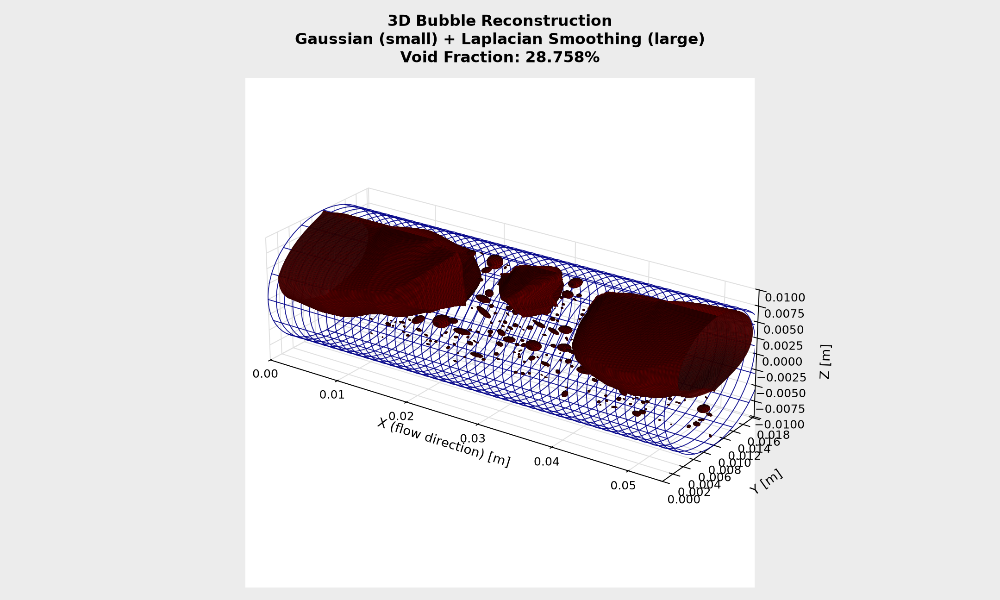
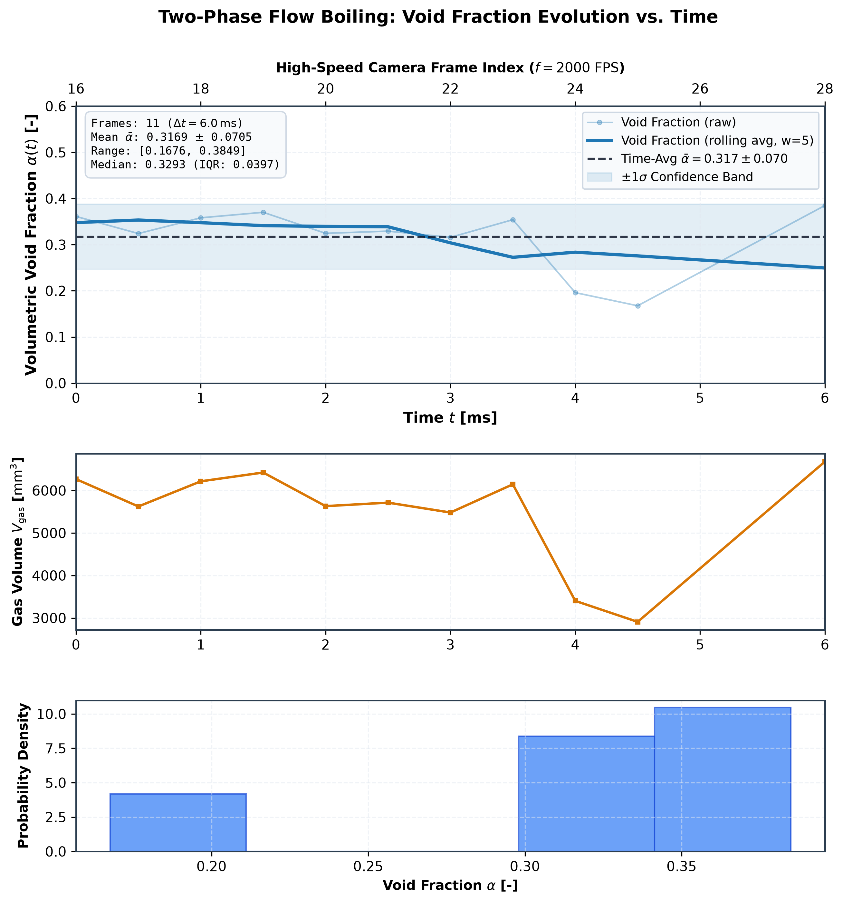
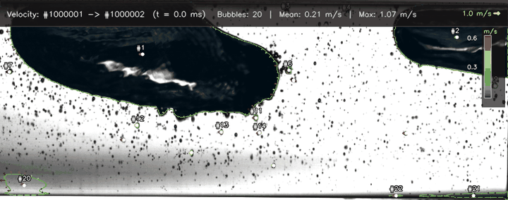
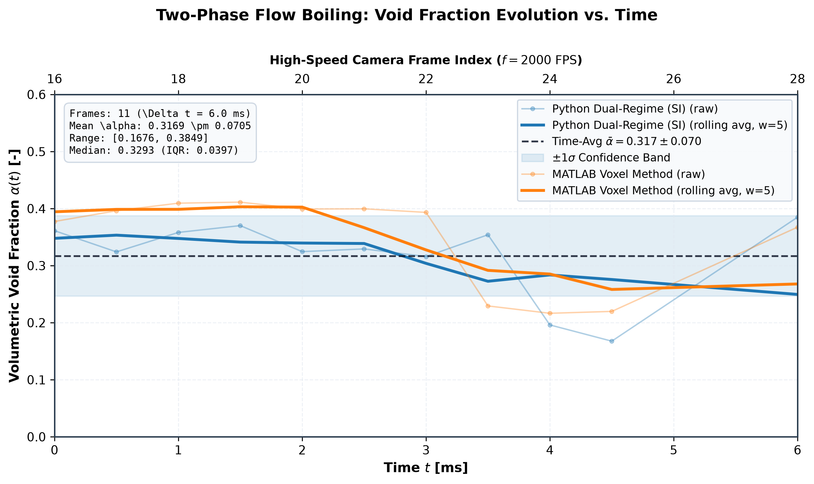

# CTF2 Python: Two-Phase Flow Boiling Image Analysis & 3D Reconstruction Pipeline

[](https://www.python.org/downloads/)
[](https://github.com/astral-sh/ruff)
[](#7-engineering-standards--si-units)

An automated computer-vision and quantitative physics pipeline for high-speed imaging of two-phase subcooled flow boiling in circular tubes. Designed for mechanical and chemical engineers, the pipeline translates high-framerate shadowgraphy footage (typically 2000 FPS) into volumetric void fraction, temporal void fraction evolution, bubble velocity fields, hydrodynamic breakup tracking, and 3D spatial bubble distributions using single-camera Depth from Defocus (DFD).

---

## Visual Showcase

| 3D Multi-Regime Flow Reconstruction | Void Fraction Timeline Evolution |
| :---: | :---: |
|  |  |

| High-Speed Velocity Field Animation (2000 FPS) | Multi-Method Benchmark Comparison |
| :---: | :---: |
|  |  |

---

## 1. Project Overview

Accurate void fraction and interfacial area concentration are foundational parameters in thermal-hydraulic modeling of cooling channels and boiling loops. In subcooled flow boiling, vapor bubble dynamics govern wall heat transfer, departure from nucleate boiling (DNB), and flow regime transitions.

This repository provides an end-to-end Python pipeline addressing the core optical challenges of flow boiling shadowgraphy:

1. **Optical Refraction & Internal Glare Protection**: Vapor bubbles act as divergent lenses with dark shadows and bright internal glare cores. The pipeline preserves original interior textures without threshold-induced core erosion.
2. **Defocus Blur Retention**: Defocus blur is retained using margin dilation, enabling single-camera Depth from Defocus (DFD) for out-of-plane depth ($z$) and in-focus diameter ($d_0$).
3. **Dual-Regime 3D Reconstruction**: Small dispersed bubbles are reconstructed as triaxial ellipsoids bounded by circular tube geometry; large elongated vapor slugs are reconstructed via distance-transform Laplacian chord extrusion.
4. **Hydrodynamic Breakup Tracking**: High-framerate tracking at 2000 FPS decouples steady translation from turbulent shear breakup using optimal bipartite matching and area conservation.
5. **Analytical Validation**: Experimental void fraction is directly validated against the Rouhani & Axelsson drift-flux theoretical correlation.
6. **Temporal Evolution & Interactive Dashboards**: Translates frame sequences into physical time axes (milliseconds or seconds), computing rolling averages, dispersion envelopes, and standalone interactive WebGL/Chart.js dashboards.

> [!NOTE]
> **Mathematical Formulations Archive**: All detailed mathematical equations, derivations, and loss formulations have been archived in [`docs/Coding/ai_reports/w40_ctf2_readme_math_removed.md`](docs/Coding/ai_reports/w40_ctf2_readme_math_removed.md) and [`ai_report/w40_ctf2_readme_math_removed.md`](ai_report/w40_ctf2_readme_math_removed.md).

---

## 2. Pipeline Architecture

```text
Raw High-Speed Shadowgraphy (2000 FPS)
  │
  ├──> Stage 0: Optical Preprocessing (image_scripts/)
  │      ├─ calibrate_pixel_size.py     --> Optical magnification calibration (m/px)
  │      ├─ 0_roi_crop.py               --> Tube geometry isolation (GUI & fixed --size locking)
  │      ├─ 1_background_subtraction.py  --> Glare & blur-preserving background subtraction (--sample-direction)
  │      ├─ 2_generate_masks.py          --> Dynamic Otsu thresholding & component filtering
  │      └─ 3_create_preannotations.py   --> Label Studio polygon serialization (Base64)
  │
  ├──> Stage 1: Machine Learning Segmentation (model_training/)
  │      ├─ 1_convert_annotations.py     --> Label Studio export to training pairs
  │      ├─ 2_train_u_net.py             --> ResNet-34 U-Net (Dice + BCE loss, MPS/CUDA)
  │      ├─ evaluate_unet_metrics.py     --> Validation metrics (IoU, Dice, Precision, Recall)
  │      └─ 3_batch_inference.py         --> Sequence inference producing binary masks
  │
  ├──> Stage 2: Quantitative Physics & 3D Reconstruction (model_training/)
  │      ├─ 4_void_fraction_reconstruct.py --> Dual-regime volume & Rouhani-Axelsson validation
  │      ├─ plot_void_fraction_timeline.py --> Publication timeline figures & interactive HTML
  │      ├─ 5_track_bubbles_kinematics.py  --> 2000 FPS velocity & breakup tracking
  │      ├─ visualize_flow_animation.py    --> Velocity vector animations (MP4/GIF)
  │      ├─ 6_depth_from_defocus.py        --> Optical depth & in-focus sizing (Rao et al.)
  │      └─ render_3d_flow.py              --> Publication 3D figures & Three.js WebGL HTML
  │
  └──> Unified CLI Orchestrator: main.py
```

---

## 3. Environment Setup & Verification

### 3.1 Setup
```bash
# Clone and enter repository
cd CTF2_python

# Activate local virtual environment
source .venv/bin/activate

# Verify Python version (>= 3.14 recommended, >= 3.12 compatible)
python --version
```

### 3.2 Automated Test Suite
Run the 40 automated unit tests covering optical calibration, ROI cropping, 3D volumetric math, Rouhani-Axelsson drift-flux, kinematic tracking, and void fraction timeline generation:

```bash
export MPLCONFIGDIR=/tmp/mpl
python -m unittest discover tests
```

---

## 4. Quickstart: Unified CLI (`main.py`)

The root `main.py` entrypoint provides a single CLI dispatcher for all pipeline stages.

| Subcommand | Aliases | Description | Key Options |
|:---|:---|:---|:---|
| `crop` | — | Conduit ROI cropping with GUI or headless mode | `--roi`, `--size`, `--ref` |
| `bg-sub` | — | Glare- and blur-preserving background subtraction | `--sample-direction`, `--threshold`, `--margin`, `--blur` |
| `calibrate` | — | Optical scale calibration (m/px) using 2 points | `-smm`, `-s`, `--copy-to` |
| `gen-masks` | — | Generate binary segmentation masks with dynamic Otsu | `--min-area`, `--max-area` |
| `void-fraction` | — | Reconstruct 3D gas volumes and void fraction CSV | `--pixel-size`, `--diameter`, `-x`, `-G`, `--render`, `--plot-timeline` |
| `plot-vf` | `plot-timeline` | Generate publication timeline and interactive HTML | `-i`, `-o`, `--html`, `--fps`, `--multi-panel` |
| `track` | — | Track bubble kinematics and breakup at 2000 FPS | `--fps`, `--pixel-size`, `--max-disp` |
| `animate-flow` | — | Render slow-motion velocity vector animations | `--fps`, `--playback-fps`, `--colormap` |
| `dfd` | — | Single-camera Depth from Defocus (DFD) analysis | `--beta-eff`, `--pixel-size` |
| `render` | — | Publication 3D flow render and Three.js WebGL HTML | `--mask`, `--output-png`, `--output-html` |

---

## 5. End-to-End Workflow Recipes

### Recipe 1: Raw Footage $\to$ 3D Void Fraction $\to$ Timeline & HTML Dashboard

```bash
# 1. Crop tube geometry (with optional fixed-size locking or previous metadata)
python main.py crop -i path/to/raw_images -o results/cropped_frames --roi 10,10,891,328

# 2. Subtract background using clean consecutive frame window to avoid ghost bubbles
python main.py bg-sub -i results/cropped_frames -o results/bg_removed --sample-direction "0,80" --threshold 25

# 3. Generate binary segmentation masks
python main.py gen-masks -i results/bg_removed -o results/segmented_masks --min-area 5

# 4. Reconstruct 3D volumes and void fraction CSV
python main.py void-fraction \
  --masks results/segmented_masks \
  -o results/void_fraction.csv \
  --pixel-size 6.1e-5 \
  --diameter 0.020 \
  -x 0.05 -G 400.0 \
  --plot-timeline
```

### Recipe 2: Bubble Kinematics & Velocity Field Animation (2000 FPS)

```bash
# 1. Track kinematics and breakup events
python main.py track \
  --masks results/segmented_masks \
  -o results/kinematics \
  --fps 2000 \
  --pixel-size 6.1e-5 \
  --max-disp 50

# 2. Render slow-motion velocity vector animation (MP4, animated GIF, HTML player)
python main.py animate-flow \
  --masks results/segmented_masks \
  -i results/cropped_frames \
  -o results/flow_animation \
  --fps 2000 \
  --playback-fps 5.0
```

### Recipe 3: Multi-Method Comparison (Python vs. MATLAB)

```bash
python main.py plot-vf \
  -i results/void_fraction_python.csv matlab_image_processing_final/matlab_void_fraction_masks.csv \
  --labels "Python Dual-Regime (SI)" "MATLAB Voxel Method" \
  -o results/void_fraction_comparison.png \
  --html results/void_fraction_comparison.html
```

---

## 6. Recent Key Features (Week 40)

- **Consecutive Range Background Estimation (`--sample-direction` / `--sample-range`)**:
  - Allows extracting background from a specific consecutive sequence window (e.g. `--sample-direction "0,80"` for the first 80 frames) rather than subsampling across the entire video.
  - **Why it matters:** In flow boiling experiments, certain sequence windows have very few or no bubbles. Sampling only in those windows prevents "ghost bubble" artifacts caused by heavy bubble traffic, achieving pristine background subtraction even when dedicated empty-channel background photos have poor alignment or shifted lighting (demonstrated in `4rd_run`).
- **Fixed Size Locking for ROI Cropping (`--size` / `-s`)**:
  - In `image_scripts/0_roi_crop.py` and `main.py crop`, `--size "W,H"` (or path to previous `0_crop_roi.txt`) locks the crop box dimensions. Users can position the box freely with mouse or arrow keys while keeping the exact image resolution across experimental runs.
- **Interactive ROI Keyboard Controls**:
  - Draggable corner handles with arrow key nudging (`Shift` for fine 1-pixel steps, `Ctrl`/`Alt` for fast 10-pixel jumps, `Tab` to cycle points).
- **Metadata Auto-loading**:
  - Cropping automatically outputs `0_crop_roi.txt` with ready-to-copy `--roi` strings, and downstream tools can accept metadata paths directly.

For full weekly details, see [`docs/Semanal/w40_ctf2_changes.md`](docs/Semanal/w40_ctf2_changes.md).

---

## 7. Engineering Standards & SI Units

All calculations and pipeline outputs strictly adhere to standard SI units:

| Physical Quantity | SI Unit | Code Flag / Variable | Typical Range |
|:---|:---|:---|:---|
| Optical Scale | $\text{m/px}$ | `--pixel-size`, `pixel_size_m` | $5\times 10^{-5} - 1\times 10^{-4}$ ($0.05 - 0.10\text{ mm/px}$) |
| Tube Diameter | $\text{m}$ | `--diameter`, `diameter_m` | $0.010 - 0.050$ ($10 - 50\text{ mm}$) |
| Gas Volume | $\text{m}^3$ | `gas_volume_m3` | $10^{-7} - 10^{-4}$ |
| Tube Volume | $\text{m}^3$ | `pipe_volume_m3` | $10^{-6} - 10^{-3}$ |
| Void Fraction | dimensionless | `void_fraction_alpha` | $0.0 - 1.0$ |
| Vapor Quality | dimensionless | `--vapor-quality`, `x` | $0.0 - 1.0$ |
| Mass Flux | $\text{kg}/(\text{m}^2\cdot\text{s})$ | `--mass-flux`, `mass_flux_G` | $100 - 2000$ |
| Bubble Velocity | $\text{m/s}$ | `velocity_m_s` | $0.5 - 15.0$ |
| Acquisition Rate | $\text{Hz}$ ($1/\text{s}$) | `--fps`, `fps` | $1000 - 10000$ |
| Defocus Constant | $\text{px/m}$ | `--beta-eff`, `beta_eff` | $1000 - 5000$ |

> **Automated Conversion Guardrail**: In `4_void_fraction_reconstruct.py` and `render_3d_flow.py`, inputs provided in millimeters (e.g. `--diameter 20.0`) are automatically detected and converted to meters ($10^{-3}$ factor).

---

## 8. Sub-Module Guides

- [Optical Preprocessing Guide](image_scripts/README.md)
- [Model Training, Physics & Timeline Guide](model_training/README.md)
- [Weekly Changes Log](docs/Semanal/w40_ctf2_changes.md)
- [Archived Mathematical Formulations](docs/Coding/ai_reports/w40_ctf2_readme_math_removed.md)
