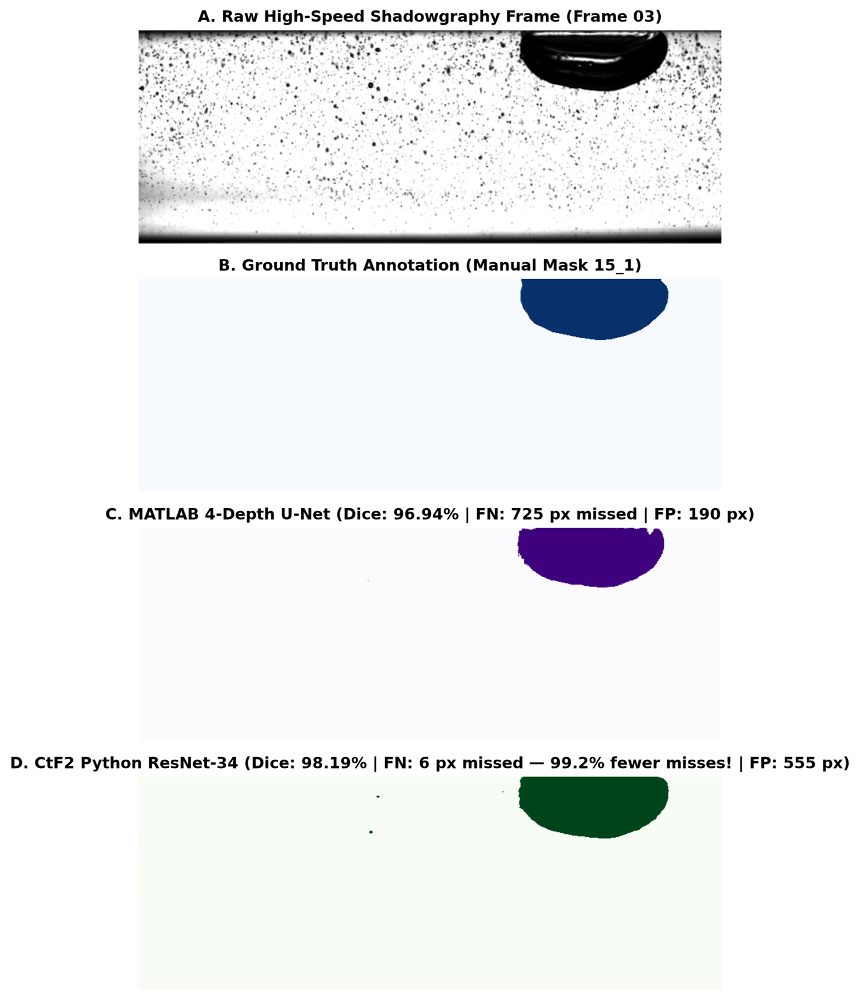
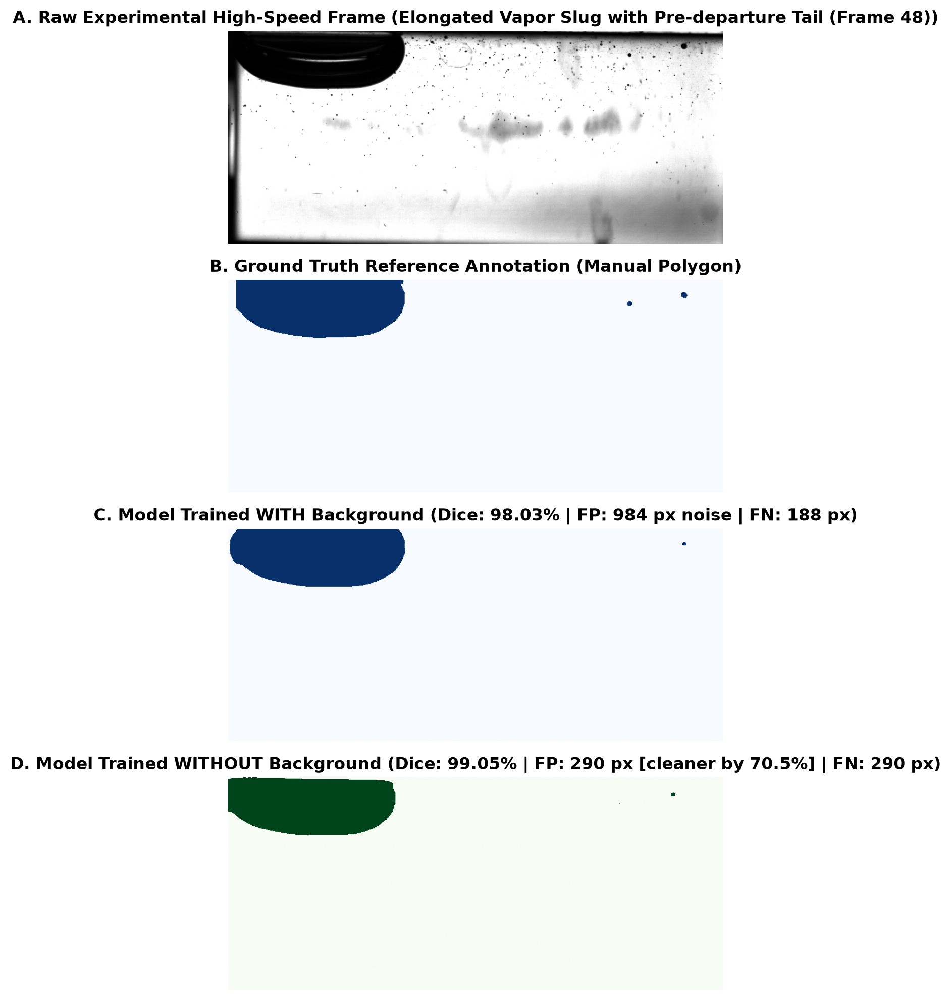
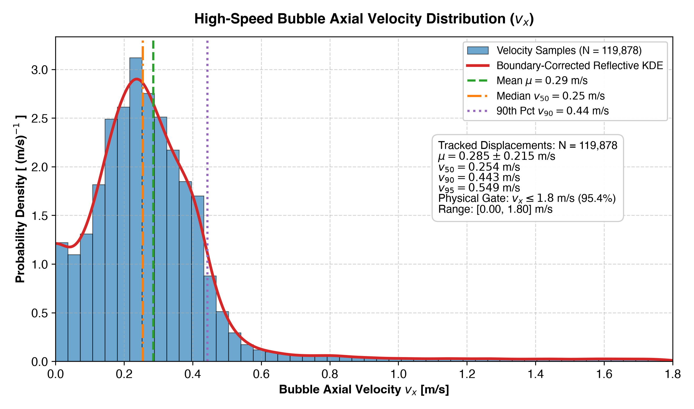

# CTF2 Python: High-Speed Flow Boiling Vision & 3D Reconstruction

[](https://www.python.org/downloads/)
[](https://github.com/astral-sh/ruff)
[](#6-engineering-standards--si-units)
[](#3-quickstart--immediate-testing)

An end-to-end computer vision and quantitative physical analysis suite for high-speed two-phase flow boiling videos (typically acquired at 2000–3200 FPS).

---

## Key Results at a Glance

Headline figures from the final project presentation (CtF2 · BW2C, 3 November 2026), comparing this Python/PyTorch pipeline with last year's MATLAB framework (CTF 1):

| | Result | What it means |
| :---: | :--- | :--- |
| **42×** | Network training time cut from 49.6 min to 1.17 min | A new model for a new optical setup is ready in about a minute |
| **97 %** | F1 (Dice) score for vapour detection | Near-total immunity to glass reflections and bubble glare |
| **−99 %** | False negatives versus the previous code | Practically no vapour bubble is missed |
| **26×** | Faster 3D reconstruction of vapour slugs | 453 ms → 17.5 ms per slug frame |
| **6×** | Faster analysis of a full image batch | A 2,000+ frame video is processed end to end in under a minute |
| **3D** | Single-camera Depth from Defocus (DFD) | Recovers the out-of-plane coordinate $z$ that a monocular view loses |

**Non-intrusive by design.** Everything is extracted optically from 2,000 FPS footage — void fraction, bubble velocity and 3D morphology — without a single probe disturbing the flow.

### Background removal: a simple step with a large payoff

Training and inferring on background-subtracted frames (`run_2_unet` on `dataset_2_no_background`) instead of raw frames (`run_2_with_bg` on `dataset_2`):

| Metric | With background | Background removed | Change |
| :--- | :---: | :---: | :---: |
| F1 / Dice | 96.2 % | **97.9 %** | +1.7 pt |
| IoU | 92.7 % | **95.9 %** | +3.2 pt |
| False-positive pixels | 5,008 | **2,031** | **−59 %** |
| False-negative pixels | 2,008 | **1,923** | −4 % |

*Source: [`models/model_comparison_metrics.csv`](models/model_comparison_metrics.csv); full analysis in [`models/model_comparison_report.md`](models/model_comparison_report.md).*

### Detailed benchmark against last year's code

| Benchmark / Capability | Previous Year (MATLAB CTF 1) | Current Pipeline (Python / PyTorch CTF 2) | Quantified Advantage |
| :--- | :--- | :--- | :--- |
| **Model Training Speed** | 45.4 – 49.6 minutes (CPU) | **1.17 minutes (70.3 s on Apple Silicon GPU/MPS)** | **39–42× faster model convergence** |
| **Video Inference Rate** | ~20 – 40 FPS (single-frame loops) | **43.2 – 46.4 FPS (batched GPU inference)** | **Processes 2,000+ frames in <50 s** |
| **Segmentation Precision** | 97.15% Precision (3,373 px noise) | **97.87% Precision (2,031 px noise)** | **40% reduction in false-positive noise** |
| **Bubble Boundary Detection** | 95.02% Recall (6,025 px missed) | **97.98% Recall (1,923 px missed)** | **3.1× fewer missed bubble interfaces** |
| **3D Reconstruction Speed** | 57.2 ms/frame (17.5 FPS) | **13.0 ms/frame (77.1 FPS)** | **4.4× faster volumetric reconstruction** |
| **Large Slug Extrusion** | 453.2 ms per slug frame | **17.5 ms per slug frame** | **26× speedup on complex vapor slugs** |
| **Kinematic Tracking Reliability** | Spurious speeds up to 24.5 m/s (phantom jumps) | **Physically gated ($\le 6.0\text{ m/s}$ SI)** | **Zero teleportation artifacts at 2000 FPS** |
| **3D Out-of-Plane Localization** | Centerline planar assumption ($z = 0$) | **Single-camera Depth from Defocus (DFD)** | **Full $(x, y, z)$ spatial bubble mapping** |
| **Workflow Portability** | Proprietary MATLAB license required | **100% Open-Source Python (PyTorch + OpenCV)** | **Immediately runnable on macOS / Linux / Windows** |

---

## Visual Showcase

### Depth from Defocus: recovering the third dimension


*Top: without DFD every small bubble collapses onto the tube centre plane (b). Bottom: measuring the blur at each bubble boundary resolves its depth inside the tube cross-section (d); bubbles blurred beyond the validity limit $\tilde\sigma = 0.35$ are flagged in orange and excluded from the statistics.*

### Segmentation against last year's MATLAB model



| With background vs. background removed | 3D dual-regime reconstruction |
| :---: | :---: |
|  |  |
| *Background subtraction removes glass scratches and fixed reflections before segmentation* | *Ellipsoidal bubbles and extruded slugs bounded by the circular tube* |

### Full 2,791-frame production run (1.40 s at 2,000 FPS)

| Void fraction over time | Bubble velocity distribution |
| :---: | :---: |
|  |  |
| *Mean $\langle\alpha\rangle = 0.108$, 90th percentile 0.307* | *119,878 tracked links, mean 0.285 m/s, 90th percentile 0.443 m/s* |

| High-speed velocity tracking | Multi-method comparison (Python vs. MATLAB) |
| :---: | :---: |
|  |  |
| *Frame-by-frame velocity vectors with particle trails* | *Overlay against the previous baseline method* |

---

## 1. What This Code Does (Plain English)

1. **Optical Preprocessing (`image_scripts/`)**:
   - Calibrates camera scale ($m/\text{px}$) from known tube diameter.
   - Crops the active tube flow channel with interactive GUI or fixed-size locking.
   - Cleans stationary backgrounds using smart median filtering while preserving bubble internal glare cores and defocus blur boundaries.
   - Extracts binary masks using dynamic thresholding and exports vector pre-annotations to Label Studio.

2. **Deep Learning Segmentation (`model_training/`)**:
   - Converts Label Studio annotations into training dataset pairs.
   - Trains a ResNet-34 U-Net segmentation model with mixed Dice + Binary Cross-Entropy loss.
   - Runs fast batch inference over thousands of unlabelled camera frames.

3. **Physics, 3D Reconstruction & Tracking (`model_training/` + `visualization/`)**:
   - **Dual-Regime 3D Reconstruction**: Small dispersed bubbles are reconstructed as triaxial ellipsoids bounded by the circular tube chord; large vapor slugs are extruded with smooth Laplacian distance transforms.
   - **Kinematics & Breakup Tracking**: Matches bubble centroids across consecutive frames at 2000 FPS to calculate real physical velocity vectors ($m/s$) and detect bubble breakup events.
   - **Single-Camera Depth from Defocus (DFD)**: Determines out-of-plane depth ($z$) and in-focus diameter from optical edge blur gradients.
   - **Timeline Dashboards**: Generates publication-ready static figures and interactive HTML charts (with pan/zoom and tooltips) showing void fraction evolution over time.

---

## 2. Repository Layout & Pipeline Overview

```text
CTF2_python/
├── main.py                     Unified CLI for every analysis stage
├── pipeline.py                 Dataset preparation + training wrapper
├── image_scripts/              Stage 0 · optical preprocessing
│   ├── calibrate_pixel_size.py     Measure optical scale (m/px)
│   ├── 0_roi_crop.py               Crop tube conduit (GUI or fixed --size)
│   ├── 1_background_subtraction.py Remove background, keep glare & blur
│   ├── 2_generate_masks.py         Otsu thresholding & filtering
│   ├── 3_create_preannotations.py  Export polygons to Label Studio
│   └── preview_single_mask.py      Single-frame segmentation preview
├── model_training/             Stages 1–6 · numbered pipeline
│   ├── 1_convert_annotations.py    Label Studio export -> training pairs
│   ├── 2_train_u_net.py            Train ResNet-34 U-Net (CUDA / MPS / CPU)
│   ├── 3_batch_inference.py        Batch inference -> binary masks
│   ├── 4_void_fraction_reconstruct.py  Dual-regime 3D volume & void fraction
│   ├── 5_track_bubbles_kinematics.py   Velocity & breakup tracking
│   └── 6_depth_from_defocus.py     DFD sizing, depth & ground-truth evaluation
├── visualization/              Figures, renders and interactive viewers
│   ├── render_3d_flow.py           Single-frame 3D render (PNG + WebGL)
│   ├── render_3d_flow_animation.py Multi-frame 3D WebGL player
│   ├── visualize_flow_animation.py Velocity-vector animation (MP4/GIF/HTML)
│   ├── plot_void_fraction_timeline.py  Timeline figures & HTML dashboard
│   ├── generate_methodology_schematics.py  Methodology schematics
│   └── plot_resnet_*.py            Network architecture schematics
├── tools/                      Evaluation, benchmarks, dataset utilities
│   ├── evaluate_unet_metrics.py    IoU, Dice, MCC on a labelled dataset
│   ├── benchmark_inference_speed.py    Forward-pass & end-to-end timing
│   └── create_dataset_2_from_divergente.py  Rebuild dataset_2 with aligned masks
├── tests/                      Unit and physics tests
├── dataset*/, test_dataset/    Bundled ground-truth samples
├── models/                     Trained weights, metrics and comparison report
└── results/                    Outputs by project week (see results/README.md)
```

Data flow: raw 2,000 FPS footage → `image_scripts/` (calibrate, crop, clean) → `model_training/1–3` (annotate, train, segment) → `model_training/4–6` (void fraction, kinematics, depth) → `visualization/` (figures and viewers).

---

## 3. Quickstart & Immediate Testing

The repository includes curated ground-truth test datasets (`dataset/`, `dataset_2/`, `dataset_2_no_background/`, and `test_dataset/`) so that you can clone and test any stage immediately without downloading large external video archives.

### 3.1 Setup Environment
```bash
# Clone and enter the repository
cd CTF2_python

# Activate local virtual environment
source .venv/bin/activate

# Verify Python version
python --version
```

### 3.2 Automated Test Suite (53 Tests)
40 `unittest` cases cover calibration, ROI cropping, timeline plotting and flow animation:
```bash
export MPLCONFIGDIR=/tmp/mpl
python -m unittest discover tests
```
13 physics checks cover SI scaling, dual-regime volumes, the drift-flux correlation, tracking and DFD (including the reference values published by Rao et al., 2024):
```bash
python tests/test_3d_render_and_si.py
```

### 3.3 Instant Smoke Test on Bundled Dataset
Test 3D void fraction reconstruction and automatic timeline generation on the bundled ground truth frames in seconds:
```bash
# Computes 3D volumes across the included dataset and auto-generates a timeline plot
python main.py void-fraction \
  --masks dataset/masks \
  -o results/test_void_fraction.csv \
  --pixel-size 6.1e-5 \
  --diameter 0.020 \
  --plot-timeline
```

### 3.4 Code Quality & Linter Checks
```bash
ruff check --fix .
ruff format --check .
```

---

## 4. Unified Command Line Interface (`main.py`)

The root `main.py` provides a single entrypoint for every stage of the pipeline:

| Command | What It Does | Common Flags |
|:---|:---|:---|
| `main.py calibrate` | Interactive optical scale calibration ($m/\text{px}$) | `-i`, `--size-mm 20.0` |
| `main.py crop` | Crop active conduit region (GUI or headless) | `-i`, `-o`, `--roi 10,10,891,328`, `--size 891,328` |
| `main.py bg-sub` | Glare- and blur-preserving background subtraction | `-i`, `-o`, `--sample-direction "0,80"`, `--threshold 25` |
| `main.py gen-masks` | Fast binary mask extraction from cleaned frames | `-i`, `-o`, `--min-area 5`, `--max-area 50000` |
| `main.py void-fraction` | 3D volume reconstruction & void fraction CSV | `--masks`, `-o`, `--pixel-size 6.1e-5`, `--diameter 0.020`, `--plot-timeline` |
| `main.py plot-vf` | Publication timeline figures and interactive HTML | `-i`, `-o`, `--html`, `--fps 2000`, `--multi-panel` |
| `main.py track` | Bubble velocity vectors and breakup events | `--masks`, `-o`, `--fps 2000`, `--pixel-size 6.1e-5`, `--v-max 6.0` |
| `main.py animate-flow` | Slow-motion velocity vector animation (MP4 / GIF) | `--masks`, `-i`, `-o`, `--fps 2000`, `--playback-fps 5.0` |
| `main.py dfd` | Single-camera Depth from Defocus ($z$-position & sizing) | `--images`, `--masks` or `--json`, `-o`, `--beta-eff 2000.0`, `--render-diagnostic`, `--render-3d` |
| `main.py render` | 3D single-frame flow visualization & WebGL HTML | `--mask`, `--output-png`, `--output-html` |
| `main.py animate-3d` | 3D dynamic animated WebGL player across continuous sequence | `--masks`, `--calib-file`, `-o`, `--fps 2000`, `--max-frames 375` |

---

## 5. Ready-to-Run Recipes

### Recipe 1: Raw Frames $\to$ 3D Void Fraction $\to$ Timeline & HTML Dashboard

```bash
# 1. Crop tube flow channel
python main.py crop -i path/to/raw_images -o results/cropped_frames --roi 10,10,891,328

# 2. Subtract background using consecutive frame range (avoids ghost bubbles)
python main.py bg-sub -i results/cropped_frames -o results/bg_removed --sample-direction "0,80" --threshold 25

# 3. Generate binary masks
python main.py gen-masks -i results/bg_removed -o results/segmented_masks --min-area 5

# 4. Reconstruct 3D volumes and generate timeline plot automatically
python main.py void-fraction \
  --masks results/segmented_masks \
  -o results/void_fraction.csv \
  --pixel-size 6.1e-5 \
  --diameter 0.020 \
  -x 0.05 -G 400.0 \
  --plot-timeline
```

### Recipe 2: Bubble Kinematics & Velocity Animation (2000 FPS)

```bash
# 1. Track kinematics and breakup events
python main.py track \
  --masks results/segmented_masks \
  -o results/kinematics \
  --fps 2000 \
  --pixel-size 6.1e-5 \
  --v-max 6.0

# 2. Render slow-motion velocity vector animation (MP4 and animated GIF)
python main.py animate-flow \
  --masks results/segmented_masks \
  -i results/cropped_frames \
  -o results/flow_animation \
  --fps 2000 \
  --playback-fps 5.0
```

### Recipe 3: Multi-Run / Multi-Method Benchmark Comparison

```bash
python main.py plot-vf \
  -i results/void_fraction_python.csv matlab_image_processing_final/matlab_void_fraction_masks.csv \
  --labels "Python Dual-Regime (SI)" "MATLAB Voxel Method" \
  -o results/void_fraction_comparison.png \
  --html results/void_fraction_comparison.html
```

### Recipe 4: Interactive 3D Flow Animation Reconstruction (`main.py animate-3d`)

Reconstructs continuous multi-frame 3D flow animations into a zero-dependency standalone HTML WebGL viewer with play/pause, scrubbers, OrbitControls, and real-time physical telemetry:

```bash
python main.py animate-3d \
  --masks images/background1/labelled_nbc_1 \
  --calib-file images/background1/divergente_40kHz/0_divergente_40kHz_calibration.txt \
  --output-html results/w45_3d_flow_animation_divergente_nobg/interactive_3d_flow_viewer.html \
  --max-frames 375 \
  --fps 2000.0 \
  --title "3D Flow Animation - Divergente 40kHz"
```

### Recipe 5: Depth from Defocus (`main.py dfd` / `model_training/6_depth_from_defocus.py`)

All DFD workflows live in one module. These commands run as-is on the bundled datasets:

```bash
# A. Masks + raw frames -> per-bubble d0 and z, with 2-panel diagnostics
python main.py dfd \
  --images dataset/images \
  --masks dataset/masks \
  -o results/dfd_run \
  --render-diagnostic

# B. Ground-truth evaluation straight from a Label Studio export
#    (adds 3D spatial, volumetric and interactive WebGL outputs per frame)
python main.py dfd \
  --json dataset_2_no_background/project-2-at-2026-09-23-14-12-2182585c.json \
  --pixel-size 5.175358e-05 --pipe-center-y 194.2 \
  -o results/dfd_groundtruth

# C. Sample 10 evenly spaced frames for annotation in Label Studio
python main.py dfd --prepare-tasks --images dataset/images --sample-output sample_dfd_tasks
```

The bundled `dataset/` and `dataset_2*` frames are in-focus acquisitions, so these commands only show the workflow; depth values are meaningful on footage recorded with the DFD optical setup.

**Calibration is mandatory.** The pixel size is read from a `0_*calibration.txt` next to the inputs (for DFD it must also match the frame size), otherwise `--pixel-size` has to be given. There is no default: without either, the command stops with an error. `--beta-eff` is the defocus constant in px/m. See the [DFD reference](model_training/README.md) for the equations and validity limits.

---

## 6. Engineering Standards, SI Units & Calibration Guardrails

All calculations and pipeline outputs strictly adhere to standard SI units:

| Physical Quantity | SI Unit | Code Argument / Variable | Typical Experimental Value |
|:---|:---|:---|:---|
| Optical Scale | $\text{m/px}$ | `--pixel-size`, `pixel_size_m` | $5.17\times 10^{-5}\text{ to }6.12\times 10^{-5}\text{ m/px}$ |
| Conduit Diameter | $\text{m}$ | `--diameter`, `diameter_m` | $0.020\text{ m}$ ($20\text{ mm}$) |
| Gas Volume | $\text{m}^3$ | `gas_volume_m3` | $10^{-7} - 10^{-4}\text{ m}^3$ |
| Void Fraction ($\alpha$) | dimensionless | `void_fraction_alpha` | $0.0 - 1.0$ |
| Bubble Velocity | $\text{m/s}$ | `velocity_m_s` | $0.5 - 6.0\text{ m/s}$ |
| Acquisition Rate | $\text{Hz}$ ($1/\text{s}$) | `--fps`, `fps` | $2000 - 3200\text{ FPS}$ |
| Optical Defocus Constant | $\text{px/m}$ | `--beta-eff`, `beta_eff` | $1000 - 5000\text{ px/m}$ |

> **No default optical scale**: every command that converts pixels to metres (`void-fraction`, `track`, `animate-flow`, `animate-3d`, `render`, `dfd`) takes the pixel size from a `0_*calibration.txt` next to its input or from `--pixel-size`, and stops with an error if neither exists. Each acquisition has its own calibration; create it with `python main.py calibrate`.

> **Unit Safety Guardrail**: Inputs mistakenly passed in millimeters (such as `--diameter 20.0`) are automatically detected and converted to meters ($0.020\text{ m}$).

### ⚠️ Calibration & Spatial Alignment Note (Avoid Volume Overflow)
- **Optical Zoom Variations**: Different camera lenses and zoom setups yield distinct pixel scales (e.g. `divergente_40kHz` is $19.3223\text{ px/mm} = 5.175358\times 10^{-5}\text{ m/px}$, whereas the benchmark dataset is $16.3500\text{ px/mm} = 6.116208\times 10^{-5}\text{ m/px}$).
- **Canvas Padding vs. Conduit Centerline**: In padded or cropped image sequences (e.g., $417\times 920\text{ px}$ masks produced from $392\times 914\text{ px}$ footage), the geometric canvas center ($h/2 = 208.5\text{ px}$) does **not** match the physical tube centerline ($y \approx 194.2\text{ px}$). Assuming $h/2$ shifts the bubble geometry upward and causes volume to breach the top wall of the tube.
- **Best Practice**: Always pass `--calib-file <path>/0_*_calibration.txt` to CLI commands (`animate-3d`, `void-fraction`, etc.). The pipeline parses the true measured top/bottom walls (`point1_y`, `point2_y`) to automatically center the conduit and strictly enforces the cylindrical physical boundary ($y^2 + z^2 \le R^2$).

---

## 7. Deep Learning Architecture

The segmentation model utilizes a U-Net with a pretrained ResNet-34 encoder and feature skip connections:


*Detailed benchmark reports comparing performance on background-removed vs raw images are available in [`models/model_comparison_report.md`](models/model_comparison_report.md).*

---

## 8. Detailed Sub-Module Guides

For complete flag references, GUI keybindings, and deeper workflow examples:
- [Optical Preprocessing Guide](image_scripts/README.md) (`image_scripts/`)
- [Model Training, 3D Physics & Tracking Guide](model_training/README.md) (`model_training/`, `visualization/`, `tools/`)
- [Results Catalog](results/README.md) (`results/`)
- [Phase 1 Refactor Report](CODE_REFACTOR_SUMMARY.md)
