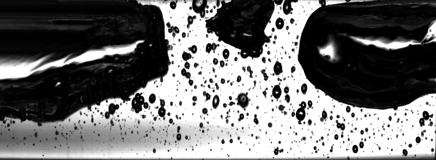
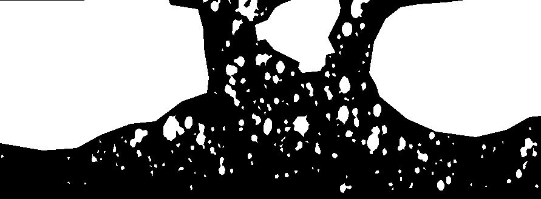

# Image Preparation and Pre-Annotation Pipeline

This module provides the image preprocessing and semi-automated annotation pipeline for high-speed two-phase flow boiling video sequences. It processes raw camera frames into clean, background-corrected images, generates initial binary bubble masks, and formats polygon predictions for vector labeling in Label Studio.

---

## 1. Physical Intuition & Optical Methodology

In high-speed flow boiling experiments, two-phase hydrodynamic structures (nucleate bubbles, slug plugs, and vapor films) are captured via backlit shadowgraphy at high framerates (typically 2000 Hz). Several optical and experimental phenomena complicate raw image segmentation:

1. **Optical Phase Inversion & Glare**: Bubbles act as divergent spherical lenses. Backlighting refracts strongly at the gas-liquid interface, producing dark outer boundary rings with bright internal glare spots in the bubble core. Direct thresholding naively cuts holes into the bubble interiors.
2. **Conduit Boundaries & Optical Vignetting**: Rigid channel walls, external mounting flanges, and non-uniform illumination fields introduce spatial noise that must be isolated through Region of Interest (ROI) cropping.
3. **Static Background Structures**: Stationary boiling nucleation sites, wall deposits, scratched sight glasses, and persistent reflections corrupt bubble shape analysis. A temporal median filter across moving flow frames reconstructs the static illumination field without ghosting.
4. **Defocus Blur Halos**: Bubbles displaced along the optical depth axis ($z$) exhibit boundary gradient softening (defocus blur). Background subtraction must expand bubble envelopes by a safety dilation margin ($\Delta r_{\text{margin}}$) to protect blur gradients required for single-camera Depth from Defocus (DFD) analysis.

```text
Raw High-Speed Sequence (2000 FPS)
  │
  ├──> Step -1: Optical Scale Calibration (calibrate_pixel_size.py)
  │      └─ Interactively calculates m/px from known tube geometry
  │
  ├──> Step 0: ROI Cropping (0_roi_crop.py)
  │      └─ Isolates active fluid conduit, removing external mounting edges
  │
  ├──> Step 1: Glare- & Blur-Preserving Background Removal (1_background_subtraction.py)
  │      └─ Temporal median subtraction with hole-filling & margin dilation
  │
  ├──> Step 2: Dynamic Binary Mask Generation (2_generate_masks.py)
  │      └─ Inverted Otsu thresholding + contour closing + component area filtering
  │
  ├──> Step 3: Label Studio Pre-Annotation Export (3_create_preannotations.py)
  │      └─ Sub-pixel polygon vectorization with base64 frame embedding
  │
  └──> Tool: Single-Frame Mask Visualizer (test_single_mask.py)
         └─ Rapid parameter tuning with side-by-side diagnostic overlays
```

---

## 2. Prerequisites & Environment Setup

All scripts execute within the project virtual environment with Python 3.14+.

```bash
# Activate virtual environment from the repository root
source .venv/bin/activate

# Verify critical imaging dependencies
python -c "import cv2, numpy, scipy, matplotlib; print('OpenCV:', cv2.__version__)"
```

Expected terminal output:
```text
OpenCV: 4.11.0
```

---

## 3. Directory Layout

The preprocessing scripts operate on local, untracked image directories:

```text
image_scripts/
├── calibrate_pixel_size.py     # Step -1: Optical scale calibrator (m/px)
├── 0_roi_crop.py               # Step 0: Interactive or headless ROI cropper
├── 1_background_subtraction.py # Step 1: Temporal median background subtraction
├── 2_generate_masks.py         # Step 2: Otsu dynamic thresholding & mask creation
├── 3_create_preannotations.py  # Step 3: Base64 JSON packaging for Label Studio
├── test_single_mask.py         # Diagnostic visualizer for single frame parameter tuning
└── README.md
```

---

## 4. End-to-End Optical Preprocessing Recipe (`Bash 1 > Bash 2 > Bash 3`)

Below is the complete chained sequence taking raw uncalibrated camera frames through calibration, cropping, background subtraction, and mask generation. Standard placeholders (`path/to/...`) can be replaced with your dataset paths (e.g. `dataset/images`, `dataset/masks`).

```bash
# Bash 1: Calibrate optical pixel size from known conduit diameter (e.g. 20 mm)
python main.py calibrate -i path/to/raw_images --size-mm 20.0
# (Alt: python image_scripts/calibrate_pixel_size.py -i path/to/raw_images -smm 20.0)

# Bash 2: Crop active fluid conduit to isolate flow channel from mounting brackets
python main.py crop -i path/to/raw_images -o results/cropped_frames --roi 10,10,891,328
# (Alt: python image_scripts/0_roi_crop.py -i path/to/raw_images -o results/cropped_frames --roi 10,10,891,328)

# Bash 3: Perform glare- and blur-preserving background subtraction
python main.py bg-sub -i results/cropped_frames -o results/bg_removed
# (Alt: python image_scripts/1_background_subtraction.py -i results/cropped_frames -o results/bg_removed)

# Bash 4: Generate binary bubble segmentation masks using dynamic Otsu thresholding
python main.py gen-masks -i results/bg_removed -o results/generated_masks --min-area 5 --max-area 50000
# (Alt: python image_scripts/2_generate_masks.py -i results/bg_removed -o results/generated_masks --min-area 5 --max-area 50000)

# Bash 5: Package masks into base64 JSON tasks for Label Studio verification
python image_scripts/3_create_preannotations.py \
  --images-dir results/bg_removed \
  --masks-dir results/generated_masks \
  --output-json results/preannotations.json
```

| Input Raw Flow Frame | Extracted Binary Mask |
| :---: | :---: |
|  |  |

> **Next Stage in the Pipeline:**
> Once masks are generated in `results/generated_masks`, you can feed them directly into:
> - **3D Void Fraction & Timeline**: `python main.py void-fraction --masks results/generated_masks --plot-timeline`
> - **Kinematic Tracking & Animation**: `python main.py track --masks results/generated_masks`

---

## 5. Step-by-Step Script Reference

### Step -1: Optical Scale Calibration (`calibrate_pixel_size.py`)

> **Prerequisites & Upstream Chain:**
> `Raw Image Sequence` $\longrightarrow$ **`calibrate`** $\longrightarrow$ Optical scale report `*.txt` (`pixel_size_m`)

Calibrates the optical magnification factor ($s_{\text{px}}$ in $\text{m/px}$) by selecting two points across a known channel dimension:

```bash
# Primary (Unified CLI):
python main.py calibrate -i path/to/raw_images --size-mm 20.0

# Direct Script Equivalent:
python image_scripts/calibrate_pixel_size.py -i path/to/raw_images -smm 20.0
```

---

### Step 0: Region of Interest (ROI) Cropping (`0_roi_crop.py`)

> **Prerequisites & Upstream Chain:**
> `Raw Image Sequence` $\longrightarrow$ **`crop`** $\longrightarrow$ `results/cropped_frames/`

Crops the active fluid conduit from raw sensor frames to eliminate mounting flanges and non-uniform boundary illumination.

#### Option A: Headless / Scripted Execution (`--roi x,y,w,h`)

```bash
# Primary (Unified CLI):
python main.py crop \
  -i path/to/raw_images \
  -o results/cropped_frames \
  --roi 10,10,891,328

# Direct Script Equivalent:
python image_scripts/0_roi_crop.py \
  --input path/to/raw_images \
  --output results/cropped_frames \
  --roi 10,10,891,328
```

#### Option B: Interactive Graphical Selection

When processing a new experimental sequence with unknown pixel bounds, omit `--roi` to launch an interactive Matplotlib selection window:

```bash
python main.py crop -i path/to/raw_images -o results/cropped_frames --ref 0
```

#### Parameter Reference

| Parameter | Type | Default | Units | Description |
| :--- | :--- | :--- | :--- | :--- |
| `--input`, `-i` | `Path` | *Required* | — | Directory containing raw uncropped camera frames. |
| `--output`, `-o` | `Path` | *Required* | — | Output directory for cropped image files. |
| `--roi` | `str` | `None` | `px` | Bounding box coordinates formatted as `x,y,w,h`. |
| `--ref` | `str` | `None` | — | Reference image index (e.g. `0`) or filename for GUI selection. |

---

### Step 1: Glare- & Blur-Preserving Background Subtraction (`1_background_subtraction.py`)

> **Prerequisites & Upstream Chain:**
> `Step 0 (results/cropped_frames)` $\longrightarrow$ **`bg-sub`** $\longrightarrow$ `results/bg_removed/`

Isolates transient vapor bubbles from stationary conduit walls while protecting both internal glare spots and outer defocus blur halos.

```bash
# Primary (Unified CLI):
python main.py bg-sub \
  -i results/cropped_frames \
  -o results/bg_removed

# Direct Script Equivalent:
python image_scripts/1_background_subtraction.py \
  --input results/cropped_frames \
  --output results/bg_removed \
  --sample-size 50 \
  --threshold 15 \
  --margin 10 \
  --bg-value 255
```

#### Parameter Reference

| Parameter | Type | Default | Units | Description |
| :--- | :--- | :--- | :--- | :--- |
| `--input`, `-i` | `Path` | *Required* | — | Input directory containing cropped flow frames. |
| `--output`, `-o` | `Path` | *Required* | — | Output directory for cleaned frames. |
| `--bg-source`, `--bg` | `Path` | `None` | — | Optional path to an empty-channel static background image or folder. |
| `--sample-size` | `int` | `50` | frames | Number of frames sampled across sequence to compute median background. |
| `--threshold`, `-t` | `int` | `15` | count (0–255) | Intensity difference threshold for detecting bubble boundary interfaces. |
| `--margin`, `-m` | `int` | `10` | `px` | Radial dilation safety padding around bubbles to preserve defocus blur. |
| `--bg-value` | `int` | `255` | count (0–255) | Fill intensity for removed static background (255 = clean white, 0 = black). |

---

### Step 2: Binary Mask Generation (`2_generate_masks.py`)

> **Prerequisites & Upstream Chain:**
> `Step 1 (results/bg_removed)` $\longrightarrow$ **`gen-masks`** $\longrightarrow$ `results/generated_masks/`

Extracts binary bubble segmentation masks from background-subtracted frames using Otsu dynamic thresholding and component area filtering:

```bash
# Primary (Unified CLI):
python main.py gen-masks \
  -i results/bg_removed \
  -o results/generated_masks \
  --min-area 5 \
  --max-area 50000

# Direct Script Equivalent:
python image_scripts/2_generate_masks.py \
  --input results/bg_removed \
  --output results/generated_masks \
  --min-area 5 \
  --max-area 50000
```

#### Parameter Reference

| Parameter | Type | Default | Units | Description |
| :--- | :--- | :--- | :--- | :--- |
| `--input`, `-i` | `Path` | *Required* | — | Directory containing background-cleaned images. |
| `--output`, `-o` | `Path` | *Required* | — | Directory where generated binary PNG masks are saved. |
| `--min-area` | `int` | `1` | `px` | Minimum connected-component area to reject sensor speckle noise. |
| `--max-area` | `int` | `50000` | `px` | Maximum connected-component area to reject full-frame lighting artifacts. |

---

### Step 3: Vector Pre-Annotation Serialization (`3_create_preannotations.py`)

> **Prerequisites & Upstream Chain:**
> `results/bg_removed` + `results/generated_masks` $\longrightarrow$ **`3_create_preannotations.py`** $\longrightarrow$ `results/preannotations.json`

Converts binary raster masks into vector polygon tasks encoded in JSON format, directly embedding base64 image data for importing into Label Studio:

```bash
python image_scripts/3_create_preannotations.py \
  --images-dir results/bg_removed \
  --masks-dir results/generated_masks \
  --output-json results/preannotations.json
```

---

### Single-Frame Diagnostic Visualizer (`test_single_mask.py`)

Provides immediate visual feedback on segmentation thresholds on a single frame before running batch operations across thousands of frames.

#### Headless Mode (Automated / CI)

```bash
python image_scripts/test_single_mask.py \
  --image dataset/images/frame_0016.png \
  --output results/test_vis.png \
  --save-mask results/test_mask.png \
  --min-area 5 \
  --max-area 50000 \
  --no-show
```

---

## 6. Label Studio Annotation Workflow

Import the generated JSON pre-annotations into Label Studio to rapidly establish verified ground-truth masks for neural network training:

### A. Labeling Interface Configuration

In Label Studio, navigate to **Project Settings** → **Labeling Interface** → **Code**, and paste the XML template below:

```xml
<View>
    <Image name="image" value="$image" zoom="true" zoomBy="1.5" zoomControl="true" rotateControl="true"/>
    <Header value="Two-Phase Flow Boiling Bubble Annotation Interface:"/>
    <BrushLabels name="brush_labels" toName="image">
        <Label value="Bubble" background="#0000FF"/>
    </BrushLabels>
    <PolygonLabels name="poly_labels" toName="image">
        <Label value="Bubble" background="#FF0000"/>
    </PolygonLabels>
</View>
```

### B. Verification & Export

1. Open the project dashboard and click **Import**.
2. Select and upload `results/preannotations.json`.
3. Open a task: pre-detected bubbles display as red vector polygons overlaid on the raw flow image.
4. Correct annotations:
   - Select and press `Backspace` / `Delete` to remove false positives (e.g. wall shadows).
   - Drag vertices to conform to bubble interface contours.
   - Use the Brush Tool (`1`) or Polygon Tool (`2`) to add undetected bubbles.
5. Click **Submit** to commit the ground-truth annotation.
6. Export the completed dataset as JSON (e.g., `model_training/project_export.json`) for downstream model training.
