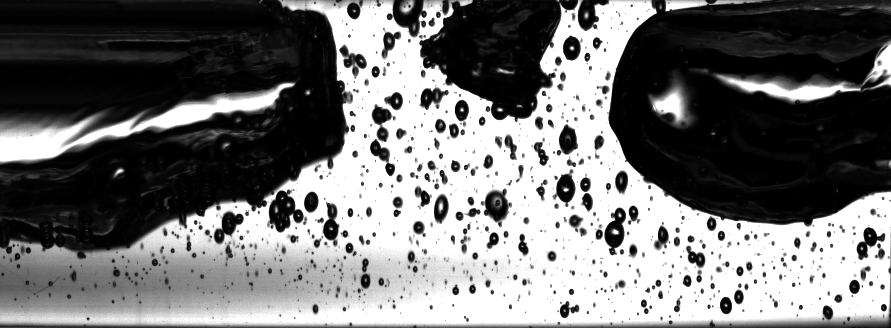
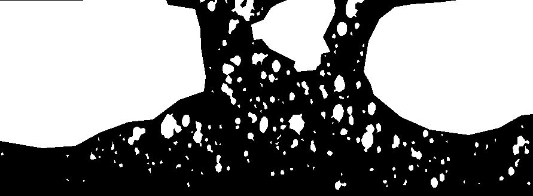
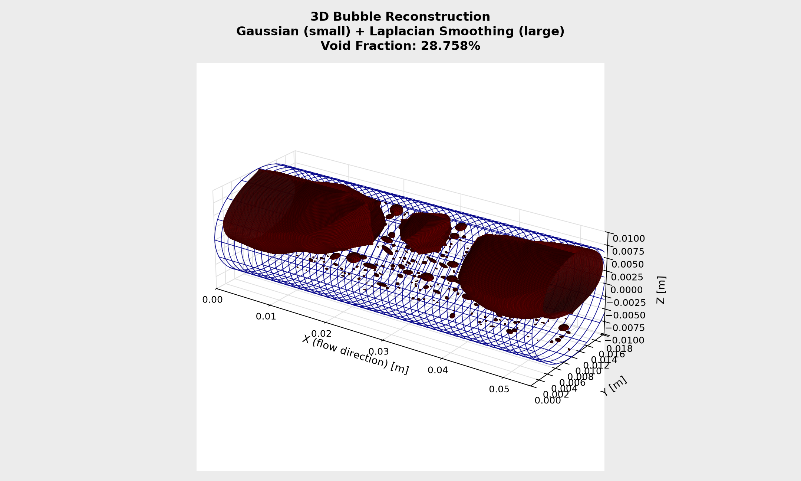
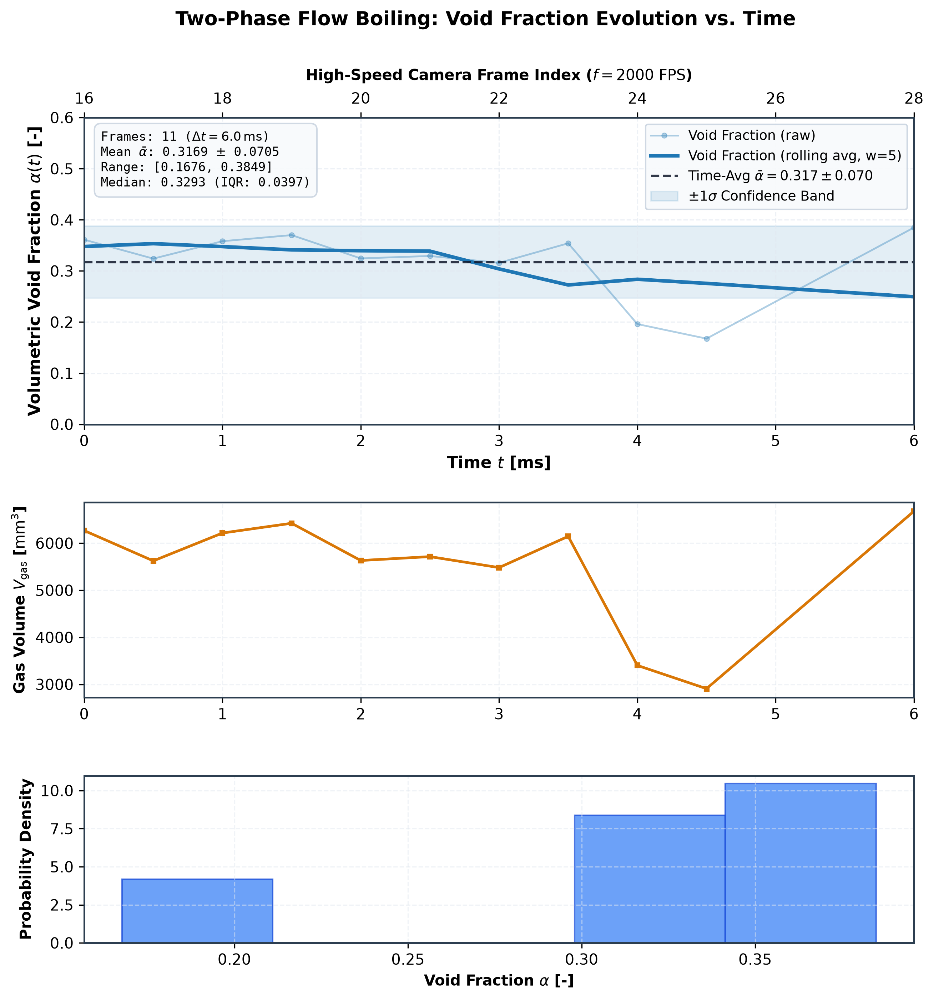
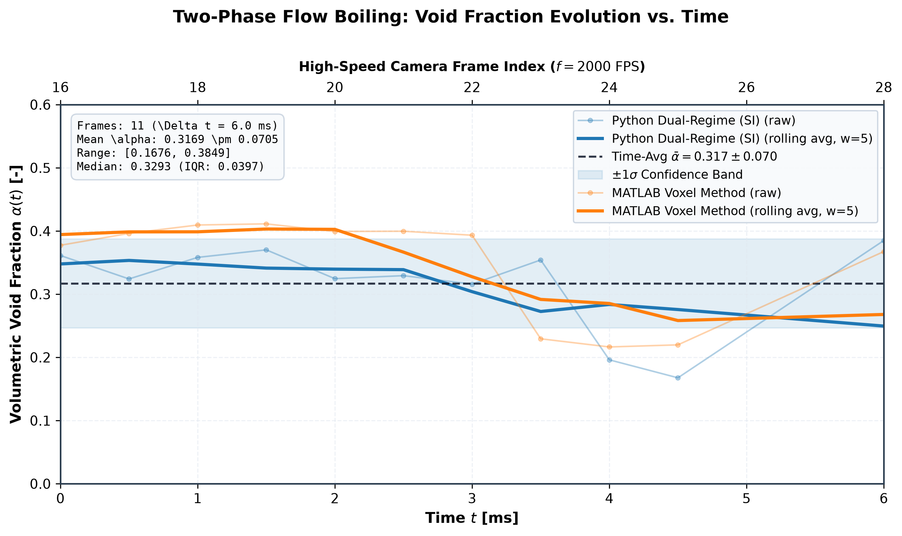

# Deep Learning Model Training & Quantitative Flow Analysis Pipeline

This directory contains the machine learning, 3D volumetric reconstruction, kinematic tracking, single-camera Depth
from Defocus (DFD) analysis, and void fraction timeline visualization pipeline for high-speed two-phase flow boiling in conduits.

The tools convert experimental annotations into training data, train a ResNet-34 U-Net segmentation network, execute
batch inference across experimental sequences, and calculate physical quantities (volumetric void fraction $\alpha$,
bubble velocities $\vec{v}$, hydrodynamic breakup events, 3D spatial coordinates $(x, y, z)$, and temporal evolution $\alpha(t)$)
strictly in standard SI units ($\text{m}$, $\text{m}^3$, $\text{m/s}$, $\text{kg}/(\text{m}^2\cdot\text{s})$).

---

## 1. Physical & Mathematical Foundations

### 1.1 U-Net Segmentation & Class Imbalance

In bubbly and slug flow regimes, vapor bubbles often occupy less than 5–30% of total image area, causing class
imbalance. The training architecture utilizes:

- **ResNet-34 Backbone**: Pretrained feature extraction transferring high-contrast boundary filters.
- **Combined Dice + BCE Loss**:
  $$\mathcal{L} = \mathcal{L}_{\text{BCE}} + \left( 1 - \frac{2 |P \cap G| + \varepsilon}{|P| + |G| + \varepsilon} \right)$$
  Where $P$ is predicted probability and $G$ is binary ground truth. Dice loss prevents gradient collapse when vapor
  area fraction is small.

### 1.2 Dual-Regime 3D Gas Volume Reconstruction

High-speed cameras capture 2D planar projections of 3D flow. Reconstructing 3D volumes requires physically consistent
assumptions based on bubble size and conduit geometry:

```text
               Planar 2D Binary Mask
                        │
         ┌──────────────┴──────────────┐
         ▼                             ▼
Small Bubbles (A < A_thresh)   Large Slugs (A >= A_thresh)
  3D Triaxial Ellipsoid           Laplacian Chord Extrusion
  a = d_major / 2                 z_chord(y) = sqrt(R^2 - delta_y^2)
  b = d_minor / 2                 D'(p) = z_chord(y) * exp(-1/(lambda*d(p)))
  c = min(b, z_chord(y))          Surface integration: 2 * sum(z * dA)
  Area-conservation guardrail     Watertight surface mesh generation
         │                             │
         └──────────────┬──────────────┘
                        ▼
           Total Gas Volume V_gas [m³]
           Conduit Volume V_pipe = pi * R² * L [m³]
           Void Fraction alpha = V_gas / V_pipe [-]
```

1. **Small Bubbles ($A < A_{\text{thresh}} = \pi R_{\text{px}}^2$)**: Modeled as triaxial ellipsoids with
   semi-axes $(a, b, c)$. The out-of-plane semi-axis $c$ is constrained by the local circular tube chord
   depth $z_{\text{chord}}(y) = \sqrt{\max(0, R^2 - \Delta y^2)}$:
   $$V_i = \frac{4}{3}\pi a b c, \quad c = \min(b, z_{\text{chord}}(y))$$
   *Area Conservation Guardrail*: To prevent fitted ellipses on irregular shapes from oversizing, semi-axes $a$ and $b$ are scaled by $s = \min(1.0, \sqrt{A_{\text{actual}} / (\pi a b)})$.
2. **Large Slugs ($A \ge A_{\text{thresh}}$)**: Elongated vapor plugs undergo wall confinement and boundary layer
   flattening. Volume is computed by extruding the local cylindrical chord profile modulated by Euclidean distance
   transform ($d(p)$) with exponential Laplacian boundary smoothing (Eduardo Reis, 2025, Eq 3.2):
   $$D'(p) = z_{\text{chord}}(y) \cdot \exp\left(-\frac{1}{\lambda \cdot d(p) + \varepsilon}\right), \quad V_i = 2 \iint D'(p) \, dA$$
3. **Volumetric Void Fraction ($\alpha$)**:
   $$\alpha = \frac{\sum_i V_i}{V_{\text{pipe}}} = \frac{\sum_i V_i}{\pi R^2 L}$$
   Where $R$ is channel inner radius (m) and $L = W_{\text{px}} \cdot s_{\text{px}}$ is the visualized channel section
   length (m).

### 1.3 Rouhani & Axelsson (1970) Drift-Flux Benchmark

The experimental void fraction is compared against the analytical Rouhani-Axelsson correlation for boiling water in
tubes:
$$\varepsilon = \frac{\frac{x}{\rho_v}}{C_0 \left( \frac{x}{\rho_v} + \frac{1-x}{\rho_l} \right) + \frac{1.18(1-x)[g \sigma (\rho_l - \rho_v)]^{0.25}}{G \sqrt{\rho_l}}}$$
Where:

- $C_0 = 1.0 + 0.12(1 - x)$ is the radial distribution parameter
- $x$ is vapor quality (dimensionless, $0.0 \le x \le 1.0$)
- $G$ is mass flux ($\text{kg}/(\text{m}^2\cdot\text{s})$)
- $\rho_l = 958.4\text{ kg/m}^3$, $\rho_v = 0.597\text{ kg/m}^3$ (water/steam at 100°C)
- $\sigma = 0.0589\text{ N/m}$, $g = 9.81\text{ m/s}^2$

### 1.4 Bubble Kinematics & Hydrodynamic Breakup (2000 FPS)

With camera temporal resolution $\Delta t = 1/\text{FPS} = 0.500\text{ ms}$, bubble centroids are tracked across
consecutive frames:

- **Optimal Bipartite Matching**: Solves linear sum assignment on the inter-frame distance cost matrix, preventing
  multi-bubble collision artifacts.
- **Hydrodynamic Breakup Detection**: When a parent bubble at frame $t$ splits into $\ge 2$ children at frame $t+1$,
  candidate children are matched within a displacement window. The split is verified via projected area conservation:
  $$\frac{|\sum A_{\text{children}} - A_{\text{parent}}|}{A_{\text{parent}}} < 0.35$$
- **Velocity Calculation**:
  $$\vec{v} = \frac{\Delta \vec{r}_{\text{px}} \cdot s_{\text{px}}}{\Delta t} \quad [\text{m/s}]$$

### 1.5 Single-Camera Depth from Defocus (DFD)

Using the calibration-free optical formulation of Rao et al. (2024), out-of-plane position $|z|$ and in-focus
diameter $d_0$ are obtained from boundary gradient blur:

1. Spatial image gradients $\nabla I$ are evaluated along the bubble interface contour.
2. Dimensionless boundary gradient $\tilde{G} = r_t |\frac{\partial g_t}{\partial r_t}|$ is matched to a precomputed
   Gaussian convolution lookup table.
3. Inversion yields dimensionless blur $\tilde{\sigma}$ and dimensionless radius $\tilde{\rho}$, yielding in-focus
   diameter $d_0 = (2 r_t) / (2 \tilde{\rho})$ and optical blur $\sigma_{\text{px}} = \tilde{\sigma} d_{0,\text{px}}$.
4. Out-of-plane physical depth $|z| = \sigma_{\text{px}} / \beta_{\text{eff}}$,
   where $\beta_{\text{eff}}$ ($\text{px/m}$) is the optical depth calibration constant.

---

## 2. Directory Layout & Artifacts

```text
model_training/
├── 1_convert_annotations.py       # Step 1: Converts Label Studio JSON to paired images/masks
├── 2_train_u_net.py               # Step 2: Trains ResNet-34 U-Net segmentation network
├── evaluate_unet_metrics.py       # Step 3: Validation metrics (IoU, Dice, MCC, Accuracy)
├── 3_batch_inference.py           # Step 4: Runs neural inference on raw sequence folders
├── 4_void_fraction_reconstruct.py # Step 5: 3D volume reconstruction & Rouhani-Axelsson benchmark
├── 5_track_bubbles_kinematics.py  # Step 6: 2000 FPS velocity tracking & breakup detection
├── 6_depth_from_defocus.py        # Step 7: Single-camera DFD depth & sizing analysis
├── render_3d_flow.py              # Step 8: 3D Matplotlib visualizer & Three.js WebGL generator
├── plot_void_fraction_timeline.py # Step 9: Publication void fraction timeline & interactive HTML
├── visualize_flow_animation.py    # Generates slow-motion MP4/GIF animations and vector fields
├── project_export.json            # Sample verified Label Studio ground-truth export
└── README.md
```

---

## 3. End-to-End Execution Recipes (`Bash 1 > Bash 2 > Bash 3`)

Below are complete, copy-pasteable command chains illustrating how data flows from initial raw camera footage down to final physics plots and dashboards. Placeholders (`path/to/...`) can be replaced with your dataset paths (e.g. `dataset/images`, `dataset/masks`).

### Recipe 1: Raw Footage $\to$ 3D Void Fraction $\to$ Timeline Plot & HTML Dashboard

```bash
# Bash 1: Crop fluid conduit from raw camera frames
python main.py crop -i path/to/raw_images -o results/cropped_frames --roi 10,10,891,328
# (Alt: python image_scripts/0_roi_crop.py -i path/to/raw_images -o results/cropped_frames --roi 10,10,891,328)

# Bash 2: Generate binary segmentation masks (Otsu dynamic thresholding or neural inference)
python main.py gen-masks -i results/cropped_frames -o results/segmented_masks
# (Alt: python image_scripts/2_generate_masks.py -i results/cropped_frames -o results/segmented_masks)

# Bash 3: Reconstruct 3D volumes, compute void fraction CSV, and render sample frame
python main.py void-fraction \
  --masks results/segmented_masks \
  -o results/void_fraction.csv \
  --pixel-size 6.1e-5 \
  --diameter 0.020 \
  -x 0.05 -G 400 \
  --render
# (Alt: python model_training/4_void_fraction_reconstruct.py --masks results/segmented_masks -o results/void_fraction.csv --pixel-size 6.1e-5 --diameter 0.020 -x 0.05 -G 400 --render)

# Bash 4: Generate publication timeline figure (PNG) and standalone interactive HTML dashboard
python main.py plot-vf \
  -i results/void_fraction.csv \
  -o results/void_fraction_timeline.png \
  --html results/void_fraction_timeline.html \
  --fps 2000 \
  --multi-panel \
  -x 0.05 -G 400
# (Alt: python model_training/plot_void_fraction_timeline.py -i results/void_fraction.csv -o results/void_fraction_timeline.png --html results/void_fraction_timeline.html --fps 2000 --multi-panel -x 0.05 -G 400)
```

> [!TIP]
> **One-Step Shortcut**: You can combine Bash 3 and Bash 4 by passing `--plot-timeline` directly to the `void-fraction` stage:
> ```bash
> python main.py void-fraction --masks results/segmented_masks -o results/void_fraction.csv --plot-timeline -x 0.05 -G 400
> ```

---

### Recipe 2: Masks $\to$ High-Speed Bubble Kinematics & Velocity Field Animation (2000 FPS)

```bash
# Bash 1: Compute bubble velocities and detect hydrodynamic breakup events at 2000 FPS
python main.py track \
  --masks results/segmented_masks \
  -o results/kinematics \
  --fps 2000 \
  --pixel-size 6.1e-5 \
  --max-disp 50
# (Alt: python model_training/5_track_bubbles_kinematics.py --masks results/segmented_masks -o results/kinematics --fps 2000 --pixel-size 6.1e-5 --max-disp 50)

# Bash 2: Render slow-motion velocity vector field animation (MP4, animated GIF, HTML player)
python main.py animate-flow \
  --masks results/segmented_masks \
  -i results/cropped_frames \
  -o results/flow_animation \
  --fps 2000 \
  --playback-fps 5.0
# (Alt: python model_training/visualize_flow_animation.py --mask-dir results/segmented_masks --image-dir results/cropped_frames --output-dir results/flow_animation --fps 2000 --playback-fps 5.0)
```

---

### Recipe 3: Single-Camera Depth from Defocus (DFD) 3D Spatial Localization

```bash
# Bash 1: Extract 3D out-of-plane depth (z) and in-focus diameter (d0) from interface blur gradients
python main.py dfd \
  --images results/cropped_frames \
  --masks results/segmented_masks \
  -o results/dfd_results.csv \
  --pixel-size 6.1e-5 \
  --beta-eff 2000.0
# (Alt: python model_training/6_depth_from_defocus.py --images results/cropped_frames --masks results/segmented_masks -o results/dfd_results.csv --pixel-size 6.1e-5 --beta-eff 2000.0)
```

---

### Recipe 4: Multi-Method Void Fraction Comparison (Python Dual-Regime vs. MATLAB)

```bash
# Bash 1: Run Python 3D dual-regime reconstruction
python main.py void-fraction --masks dataset/masks -o results/void_fraction_python.csv

# Bash 2: Plot comparative overlay against MATLAB voxel/analytical benchmark
python main.py plot-vf \
  -i results/void_fraction_python.csv matlab_image_processing_final/matlab_void_fraction_masks.csv \
  --labels "Python Dual-Regime (SI)" "MATLAB Voxel Method" \
  -o results/void_fraction_comparison.png \
  --html results/void_fraction_comparison.html
```

---

## 4. Step-by-Step Script Reference

Activate the virtual environment from the repository root before running any scripts:

```bash
source .venv/bin/activate
```

---

### Step 1: Convert Annotations to Training Pairs (`1_convert_annotations.py`)

> **Prerequisites & Upstream Chain:**
> `Label Studio Export (.json)` $\longrightarrow$ **`1_convert_annotations.py`** $\longrightarrow$ `dataset/images/` + `dataset/masks/`

Converts exported Label Studio JSON vector polygons into rasterized binary masks (PNG) and extracts base64 raw frames:

```bash
# Unified / Direct Script Call:
python model_training/1_convert_annotations.py \
  --json model_training/project_export.json \
  --dataset dataset
```

Expected terminal output:
```text
[DONE] Extracted 11 images to: dataset/images
[DONE] Extracted 11 masks to: dataset/masks
```

#### Parameter Reference

| Parameter         | Type   | Default    | Units | Description                                                     |
|:------------------|:-------|:-----------|:------|:----------------------------------------------------------------|
| `--json`, `-j`    | `Path` | *Required* | —     | Path to Label Studio exported JSON file.                        |
| `--dataset`, `-d` | `Path` | `dataset`  | —     | Target dataset root directory (creates `images/` and `masks/`). |

---

### Step 2: Train the U-Net Segmentation Model (`2_train_u_net.py`)

> **Prerequisites & Upstream Chain:**
> `Step 1 (dataset/images & dataset/masks)` $\longrightarrow$ **`2_train_u_net.py`** $\longrightarrow$ `models/best_bubble_unet.pth`

Trains a ResNet-34 U-Net with automatic device selection (`cuda` on Linux GPUs, `mps` on Apple Silicon, or `cpu`):

```bash
# Unified / Direct Script Call:
python model_training/2_train_u_net.py \
  --dataset dataset \
  --output-model models/run_1_unet.pth \
  --epochs 20 \
  --batch-size 4 \
  --lr 1e-3
```

Expected terminal output:
```text
Training on device: mps
Epoch [01/20] - Train Loss: 0.8238 | Val Loss: 0.7911
  --> Saved best model checkpoint to: models/run_1_unet.pth
...
Epoch [20/20] - Train Loss: 0.2315 | Val Loss: 0.2840
  --> Saved best model checkpoint to: models/run_1_unet.pth
```

#### Parameter Reference

| Parameter              | Type    | Default                | Units   | Description                                              |
|:-----------------------|:--------|:-----------------------|:--------|:---------------------------------------------------------|
| `--dataset`, `-d`      | `Path`  | `dataset`              | —       | Root directory containing `images/` and `masks/`.        |
| `--output-model`, `-o` | `Path`  | `best_bubble_unet.pth` | —       | Path to save the best model weights checkpoint (`.pth`). |
| `--epochs`, `-e`       | `int`   | `40`                   | cycles  | Total training epochs across the dataset.                |
| `--batch-size`, `-b`   | `int`   | `8`                    | frames  | Mini-batch size for DataLoader.                          |
| `--lr`                 | `float` | `0.001`                | —       | Initial learning rate for AdamW optimizer.               |
| `--num-workers`        | `int`   | `0`                    | threads | DataLoader subprocess workers (0 recommended on macOS).  |

---

### Step 3: Evaluate Model Performance (`evaluate_unet_metrics.py`)

> **Prerequisites & Upstream Chain:**
> `Step 2 (models/*.pth)` + `dataset/` $\longrightarrow$ **`evaluate_unet_metrics.py`** $\longrightarrow$ `results/model_validation_metrics.csv`

Computes pixel-level classification metrics on the validation split:

```bash
# Unified / Direct Script Call:
python model_training/evaluate_unet_metrics.py \
  --model models/run_1_unet.pth \
  --dataset dataset \
  --output-csv results/model_validation_metrics.csv
```

Expected terminal output:
```text
Running evaluation on device: mps
Evaluating on 3 validation frame(s)...

=============================================
       U-NET SEGMENTATION PERFORMANCE
=============================================
Total Pixels Analyzed : 876,744
True Positives  (TP)  : 307,880
True Negatives  (TN)  : 431,610
False Positives (FP)  : 67,412
False Negatives (FN)  : 69,842
---------------------------------------------
Accuracy              : 0.8435
Precision             : 0.8204
Recall (Sensitivity)  : 0.8151
Specificity           : 0.8649
F1-Score (Dice)       : 0.8177
Jaccard Index (IoU)   : 0.6917
MCC                   : 0.6806
=============================================
[SAVED] Results exported to: results/model_validation_metrics.csv
```

---

### Step 4: Batch Inference Across Sequences (`3_batch_inference.py`)

> **Prerequisites & Upstream Chain:**
> `Cropped Frames` + `Step 2 (models/*.pth)` $\longrightarrow$ **`3_batch_inference.py`** $\longrightarrow$ `results/segmented_masks/*.png`

Processes a full sequence of raw high-speed flow frames to produce high-resolution binary masks:

```bash
# Direct Script Call:
python model_training/3_batch_inference.py \
  --input dataset/images \
  --output results/segmented_masks \
  --model models/run_1_unet.pth
```

| Input Raw Frame | Output Binary Mask |
| :---: | :---: |
|  |  |

#### Parameter Reference

| Parameter        | Type   | Default                | Units | Description                                    |
|:-----------------|:-------|:-----------------------|:------|:-----------------------------------------------|
| `--input`, `-i`  | `Path` | *Required*             | —     | Directory containing raw cropped flow frames.  |
| `--output`, `-o` | `Path` | *Required*             | —     | Directory to write predicted binary mask PNGs. |
| `--model`, `-m`  | `Path` | `best_bubble_unet.pth` | —     | Trained model checkpoint weights.              |

---

### Step 5: 3D Void Fraction Reconstruction (`4_void_fraction_reconstruct.py`)

> **Prerequisites & Upstream Chain:**
> `Binary Masks (Step 4 / gen-masks)` $\longrightarrow$ **`void-fraction`** $\longrightarrow$ `results/void_fraction.csv` (+ optional sample 3D render)

Reconstructs frame-by-frame 3D gas volumes and void fraction $\alpha$, with optional Rouhani-Axelsson benchmark comparison, sample 3D visual rendering, and automated timeline generation:

```bash
# Primary (Unified CLI):
python main.py void-fraction \
  --masks dataset/masks \
  -o results/void_fraction.csv \
  --pixel-size 6.1e-5 \
  --diameter 0.020 \
  -x 0.05 \
  -G 400.0 \
  --render \
  --render-output results/3d_reconstruction_sample.png

# Direct Script Equivalent:
python model_training/4_void_fraction_reconstruct.py \
  --masks dataset/masks \
  --output-csv results/void_fraction.csv \
  --pixel-size 6.1e-5 \
  --diameter 0.020 \
  --vapor-quality 0.05 \
  --mass-flux 400.0 \
  --render \
  --render-output results/3d_reconstruction_sample.png
```



Expected terminal output:
```text
Executing 3D void fraction reconstruction in standard SI units:
  Masks count         : 11
  Pixel size (SI)     : 6.116208e-05 m/px (0.0612 mm/px)
  Channel diameter (SI): 2.000000e-02 m (20.00 mm)
  Channel radius (SI) : 1.000000e-02 m (163.5 px)

====================================================
      VOID FRACTION RECONSTRUCTION SUMMARY (SI)
====================================================
Frames Analyzed     : 11
Mean Alpha (alpha_exp): 0.2503 (25.028%)
Min Alpha           : 0.1274
Max Alpha           : 0.3164
Standard Dev        : 0.0777
Mean Gas Volume     : 4.284911e-06 m³
Mean Pipe Volume    : 1.712024e-05 m³
----------------------------------------------------
     ROUHANI-AXELSSON THEORETICAL BENCHMARK (SI)
----------------------------------------------------
Vapor Quality (x)   : 0.0500 [-]
Mass Flux (G)       : 400.0 kg/(m² s)
Theoretical Void (ε): 0.8831 (88.31%)
Relative Difference : 71.66 %
====================================================
Results saved to    : results/void_fraction.csv
```

#### Parameter Reference

| Parameter               | Type    | Default                             | Units                                 | Description                                                                               |
|:------------------------|:--------|:------------------------------------|:--------------------------------------|:------------------------------------------------------------------------------------------|
| `--masks`, `-m`         | `Path`  | *Required*                          | —                                     | Directory containing binary mask PNGs.                                                    |
| `--output-csv`, `-o`    | `Path`  | `results/void_fraction.csv`         | —                                     | Output CSV path for frame-by-frame void fraction logs.                                    |
| `--pixel-size`          | `float` | `Auto-loaded` or `6.1e-5`           | $\text{m/px}$                         | Optical scale in meters per pixel ($6.1\times 10^{-5}\text{ m/px} = 0.061\text{ mm/px}$). |
| `--diameter`, `-d`      | `float` | `Auto-loaded` or `0.020`            | $\text{m}$                            | Channel inner diameter in meters ($0.020\text{ m} = 20\text{ mm}$).                       |
| `--vapor-quality`, `-x` | `float` | `None`                              | dimensionless                         | Thermodynamic vapor quality $x$ ($0.0 \le x \le 1.0$).                                    |
| `--mass-flux`, `-G`     | `float` | `None`                              | $\text{kg}/(\text{m}^2\cdot\text{s})$ | Total flow mass flux $G$.                                                                 |
| `--render`              | `flag`  | `False`                             | —                                     | Renders a sample 3D flow visualization artifact.                                          |
| `--render-output`       | `Path`  | `None`                              | —                                     | Path for rendered 3D image artifact.                                                      |
| `--plot-timeline`       | `flag`  | `False`                             | —                                     | Automatically creates timeline figure and HTML dashboard upon completion.                 |
| `--fps`                 | `float` | `2000.0`                            | $\text{Hz}$                           | Camera framerate in FPS for timeline mapping.                                             |

---

### Step 6: Bubble Kinematics & Breakup Tracking (`5_track_bubbles_kinematics.py`)

> **Prerequisites & Upstream Chain:**
> `Binary Masks (Step 4 / gen-masks)` $\longrightarrow$ **`track`** $\longrightarrow$ `results/kinematics/*.csv` $\longrightarrow$ **`animate-flow`** $\longrightarrow$ MP4 / GIF

Tracks bubble centroids at 2000 FPS and identifies hydrodynamic breakup events:

```bash
# Primary (Unified CLI):
python main.py track \
  --masks dataset/masks \
  -o results/kinematics \
  --fps 2000 \
  --pixel-size 6.1e-5 \
  --max-disp 50

# Direct Script Equivalent:
python model_training/5_track_bubbles_kinematics.py \
  --masks dataset/masks \
  --output-dir results/kinematics \
  --fps 2000 \
  --pixel-size 6.1e-5 \
  --max-disp 50
```

To render the slow-motion animated vector field with particle trajectory trails:

```bash
python main.py animate-flow \
  --masks dataset/masks \
  -i dataset/images \
  -o results/flow_animation \
  --fps 2000 \
  --playback-fps 5.0
```


#### Generated Outputs:
1. `bubble_velocities_si.csv`: Columns `[frame_t, frame_t1, bubble_id, velocity_m_s, displacement_m, dx_m, dy_m, area_m2, is_stable_count_pair]`
2. `bubble_breakups_si.csv`: Columns `[frame_t, frame_t1, parent_id, parent_area_m2, total_child_area_m2, area_error_rel, num_children, parent_dx_m, parent_dy_m]`
3. `bubble_velocity_flow_animation.mp4` / `.gif`: Visual slow-motion video with vector arrows colored by velocity magnitude.

---

### Step 7: Single-Camera Depth from Defocus (`6_depth_from_defocus.py`)

> **Prerequisites & Upstream Chain:**
> `Raw Images` + `Binary Masks` $\longrightarrow$ **`dfd`** $\longrightarrow$ `results/dfd_results.csv`

Extracts 3D spatial position $(x, y, z)$ and in-focus diameter $d_0$ using boundary gradient blur analysis:

```bash
# Primary (Unified CLI):
python main.py dfd \
  --images dataset/images \
  --masks dataset/masks \
  -o results/dfd_results.csv \
  --pixel-size 6.1e-5 \
  --beta-eff 2000.0

# Direct Script Equivalent:
python model_training/6_depth_from_defocus.py \
  --images dataset/images \
  --masks dataset/masks \
  --output-csv results/dfd_results.csv \
  --pixel-size 6.1e-5 \
  --beta-eff 2000.0
```

#### Generated Outputs:
`dfd_results.csv`: Contains `[bubble_id, centroid_x_m, centroid_y_m, depth_z_m, diameter_d0_m, blur_sigma_px, sigma_tilde, g_tilde, area_px, frame]`.

---

### Step 8: Publication-Grade 3D Flow Rendering (`render_3d_flow.py`)

> **Prerequisites & Upstream Chain:**
> `Single Binary Mask (Step 4 / gen-masks)` $\longrightarrow$ **`render`** $\longrightarrow$ `results/3d_render.png` + `results/3d_render.html`

Renders full 3D flow structure in a cylindrical conduit to high-resolution PNG and interactive WebGL HTML:

```bash
# Primary (Unified CLI):
python main.py render \
  --mask dataset/masks/frame_0016.png \
  --output-png results/3d_bubble_render.png \
  --output-html results/3d_bubble_render.html \
  --pixel-size 6.1e-5 \
  --diameter 0.020

# Direct Script Equivalent:
python model_training/render_3d_flow.py \
  --mask dataset/masks/frame_0016.png \
  --output results/3d_bubble_render.png \
  --interactive-html results/3d_bubble_render.html \
  --pixel-size 6.1e-5 \
  --diameter 0.020
```

---

### Step 9: Void Fraction Timeline Plotting & Interactive Dashboard (`plot_void_fraction_timeline.py`)

> **Prerequisites & Upstream Chain:**
> `results/void_fraction.csv (Step 5)` $\longrightarrow$ **`plot-vf`** $\longrightarrow$ `results/void_fraction_timeline.png` + `results/void_fraction_timeline.html`

Generates publication-quality static figures (PNG/PDF/SVG) and standalone interactive HTML dashboards showing the evolution of volumetric void fraction $\alpha(t)$ throughout high-speed camera time:

```bash
# Primary (Unified CLI):
python main.py plot-vf \
  -i results/void_fraction.csv \
  -o results/void_fraction_timeline.png \
  --html results/void_fraction_timeline.html \
  --fps 2000 \
  --multi-panel \
  -x 0.05 \
  -G 400.0

# Direct Script Equivalent:
python model_training/plot_void_fraction_timeline.py \
  --input results/void_fraction.csv \
  --output results/void_fraction_timeline.png \
  --html results/void_fraction_timeline.html \
  --fps 2000 \
  --multi-panel \
  --vapor-quality 0.05 \
  --mass-flux 400.0
```

| Multi-Panel Timeline Analysis | Method Comparison Overlay |
| :---: | :---: |
|  |  |

#### Features & Display Elements:
- **Dual Temporal/Frame Axes**: Bottom axis shows physical time $t$ in $\text{ms}$ (or $\text{s}$), top axis shows camera frame index ($2000\text{ FPS}$, $\Delta t = 0.5\text{ ms}$).
- **Moving Average Smoothing**: Centered rolling average curve with configurable temporal window size (`-w 5`).
- **Statistical Dispersion Band**: Dashed time-averaged mean line ($\bar{\alpha}$) with $\pm 1\sigma$ standard deviation translucent confidence envelope.
- **Theoretical Reference Line**: Analytical Rouhani & Axelsson (1970) drift-flux benchmark line ($\varepsilon_{\text{th}}$) with relative error badge.
- **Multi-Panel Mode (`--multi-panel`)**: Three-panel layout including $\alpha(t)$, gas volume evolution $V_{\text{gas}}(t)$ in $\text{mm}^3$, and void fraction probability distribution histogram.
- **Comparative Multi-Run Overlay**: Ingests multiple CSV files simultaneously (e.g. Python vs. MATLAB) and overlays traces on a common time axis with custom labels.
- **Interactive HTML Viewer**: Zero-dependency Chart.js dashboard supporting pan/zoom, hover tooltips, and interactive frame measurement tables.

#### Parameter Reference

| Parameter                   | Type    | Default                                 | Units         | Description                                                               |
|:----------------------------|:--------|:----------------------------------------|:--------------|:--------------------------------------------------------------------------|
| `--input`, `-i`             | `Path+` | *Required*                              | —             | Path(s) to void fraction CSV file(s) or directory. Supports globbing.     |
| `--output`, `-o`            | `Path`  | `results/void_fraction_timeline.png`    | —             | Output path for publication figure (`.png`, `.svg`, or `.pdf`).           |
| `--html`, `--interactive-html` | `Path` | `results/void_fraction_timeline.html`   | —             | Output path for standalone interactive HTML viewer.                       |
| `--no-html`                 | `flag`  | `False`                                 | —             | Disables interactive HTML viewer generation.                              |
| `--fps`                     | `float` | `2000.0`                                | $\text{Hz}$   | High-speed camera acquisition framerate (default: $2000\text{ FPS}$).     |
| `--time-unit`               | `str`   | `ms`                                    | `ms` or `s`   | Physical time unit for timeline axis.                                     |
| `--absolute-time`           | `flag`  | `False`                                 | —             | Uses absolute camera frame timestamp instead of $t=0$ relative start.     |
| `--rolling-window`, `-w`    | `int`   | `5`                                     | frames        | Moving average smoothing window size.                                     |
| `--vapor-quality`, `-x`     | `float` | `None`                                  | dimensionless | Vapor quality for Rouhani-Axelsson benchmark.                             |
| `--mass-flux`, `-G`         | `float` | `None`                                  | $\text{kg}/(\text{m}^2\cdot\text{s})$ | Total mass flux for Rouhani-Axelsson benchmark.           |
| `--multi-panel`             | `flag`  | `False`                                 | —             | Enables 3-panel layout ($\alpha(t)$, $V_{\text{gas}}(t)$, and histogram).|
| `--labels`                  | `str+`  | `None`                                  | —             | Custom series names when overlaying multiple CSV files.                   |
| `--alpha-col`               | `str`   | `None`                                  | —             | Explicit void fraction column name (auto-detected if omitted).            |
| `--dpi`                     | `int`   | `300`                                   | —             | Output raster image resolution (default: 300 DPI).                        |
