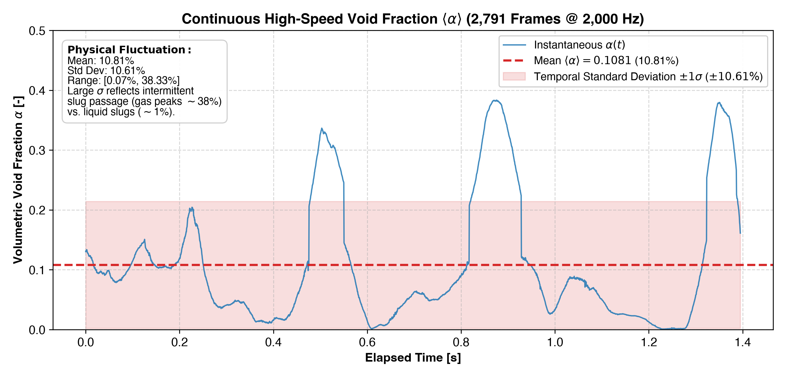
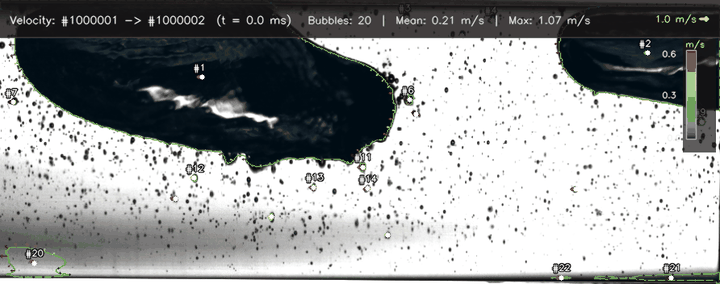
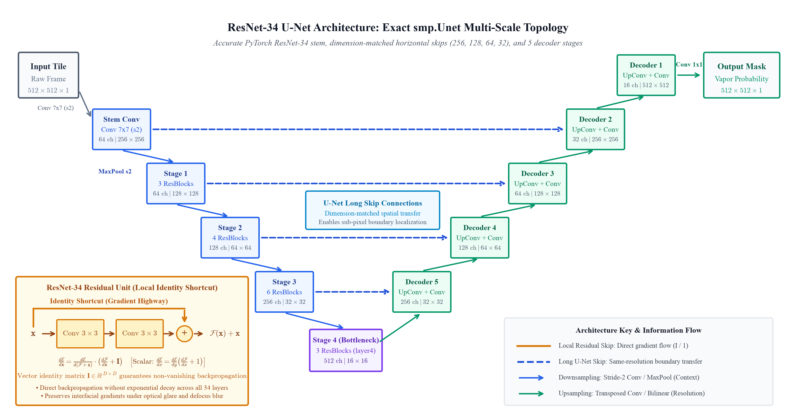
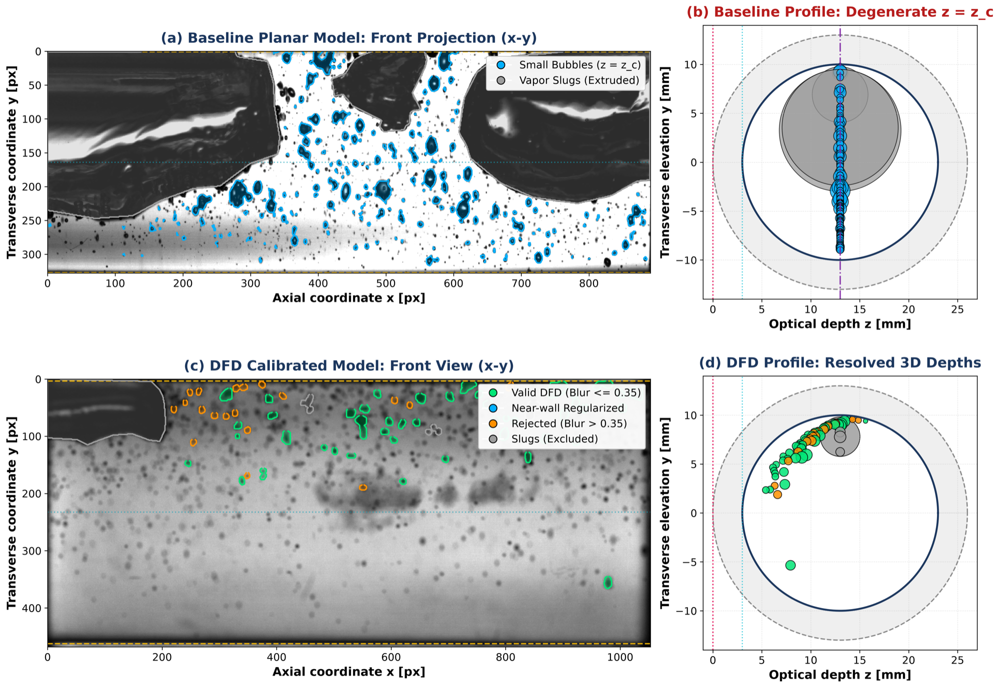
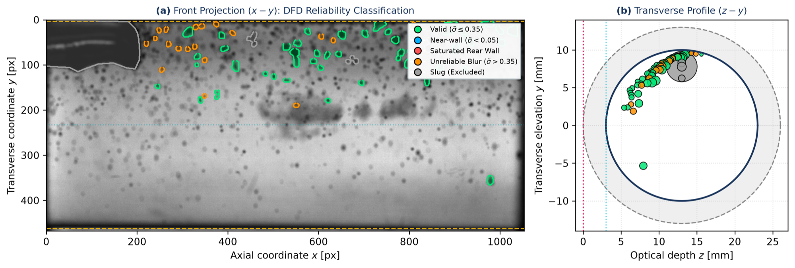

# Deep Learning Segmentation, 3D Physics & Tracking (`model_training`)

This directory holds the numbered pipeline stages: neural network segmentation, 3D volume reconstruction, high-speed kinematic bubble tracking (2000+ FPS) and single-camera Depth from Defocus (DFD). Renderers and plots live in [`../visualization/`](../visualization/README.md); evaluation and benchmark utilities live in [`../tools/`](../tools/README.md).

---

## Visual Showcase

| 3D Dual-Regime Bubble Flow | Physical Void Fraction Timeline |
| :---: | :---: |
|  |  |
| *Watertight 3D reconstruction bounded by cylindrical tube walls* | *Physical time evolution with rolling mean & confidence bands* |

| High-Speed Velocity Field Animation (2000 FPS) | U-Net Segmentation Architecture |
| :---: | :---: |
|  |  |
| *Frame-by-frame velocity vectors with particle trails* | *Pretrained ResNet-34 encoder with matched skip connections* |

---

### Depth from Defocus versus the planar baseline



*Without DFD all small bubbles sit on the tube centre plane (b); with DFD each one gets its own depth (d). Orange: rejected, blur beyond $\tilde\sigma = 0.35$.*

---

## 1. What This Code Does (Plain English)

1. **Neural Network Bubble Segmentation**:
   - Trains a ResNet-34 U-Net network using a balanced Dice + Binary Cross-Entropy loss. This handles small bubbles occupying as little as 5% of the frame without losing detection precision.
   - Runs fast batch inference (over 46 FPS on Apple Silicon / CUDA GPUs) across thousands of raw video frames.

2. **Dual-Regime 3D Bubble Volume Reconstruction**:
   - A single 2D camera view cannot directly show depth. This pipeline uses physics-based geometric bounds:
     - **Small bubbles**: Modeled as 3D ellipsoids, with their depth strictly capped by the local physical width of the circular tube.
     - **Large vapor slugs**: Extruded across the tube cross-section with smooth distance transforms so they don't artificially breach the pipe walls.
   - Outputs total gas volume ($m^3$) and physical volumetric void fraction ($\alpha = V_{\text{gas}} / V_{\text{pipe}}$).

3. **High-Speed Velocity Tracking & Breakup Detection (2000 FPS)**:
   - At high camera framerates, bubbles move only small distances between frames. An optimal matching algorithm tracks each bubble's trajectory, computing its speed ($m/s$).
   - Detects when a parent bubble splits into two or more daughter bubbles by checking position and area conservation.

4. **Single-Camera Depth from Defocus (DFD)**:
   - Evaluates the optical blur sharpness of each bubble's outer edge.
   - Infers both the true in-focus diameter and the out-of-plane physical depth ($z$) inside the fluid column.

5. **Timeline Figures & Interactive Dashboards**:
   - Converts frame indices to physical milliseconds based on camera framerate.
   - Generates publication-ready figures (PNG, PDF) and standalone interactive HTML dashboards (with pan, zoom, and inspection tables).

---

## 2. Directory Layout

```text
model_training/
├── 1_convert_annotations.py       # Stage 1: Label Studio JSON -> training image/mask pairs
├── 2_train_u_net.py               # Stage 2: train the ResNet-34 U-Net
├── 3_batch_inference.py           # Stage 3: batch inference across frame sequences
├── 4_void_fraction_reconstruct.py # Stage 4: dual-regime 3D volumes and void fraction CSV
├── 5_track_bubbles_kinematics.py  # Stage 5: velocity tracking and breakup detection
├── 6_depth_from_defocus.py        # Stage 6: DFD sizing, depth and ground-truth evaluation
├── project_export.json            # Sample Label Studio export (untracked)
└── README.md

visualization/                     # called by the stages above and by main.py
├── render_3d_flow.py              # single-frame 3D render (PNG + WebGL HTML)
├── render_3d_flow_animation.py    # multi-frame animated 3D WebGL player
├── visualize_flow_animation.py    # slow-motion velocity-vector MP4/GIF/HTML
└── plot_void_fraction_timeline.py # timeline figures and interactive dashboard

tools/
├── evaluate_unet_metrics.py       # validation metrics (IoU, Dice, MCC, accuracy)
├── benchmark_inference_speed.py   # forward-pass and end-to-end timing
└── create_dataset_2_from_divergente.py
```

Every script runs on its own (`python model_training/<script>.py --help`) or through the unified CLI (`python main.py <command>`).

---

## 3. End-to-End Execution Recipes

### Recipe 1: Masks $\to$ 3D Void Fraction $\to$ Timeline Plot & Interactive HTML

```bash
# 1. Reconstruct 3D volumes, void fraction CSV, and render sample frame
python main.py void-fraction \
  --masks dataset/masks \
  -o results/void_fraction.csv \
  --pixel-size 6.1e-5 \
  --diameter 0.020 \
  -x 0.05 -G 400.0 \
  --render \
  --plot-timeline
```

Or run the timeline generator separately with custom multi-panel layouts:

```bash
python main.py plot-vf \
  -i results/void_fraction.csv \
  -o results/void_fraction_timeline.png \
  --html results/void_fraction_timeline.html \
  --fps 2000 \
  --multi-panel \
  -x 0.05 -G 400.0
```

---

### Recipe 2: Bubble Kinematics & Velocity Vector Field Animation (2000 FPS)

```bash
# 1. Compute velocity vectors and detect breakup events
python main.py track \
  --masks dataset/masks \
  -o results/kinematics \
  --fps 2000 \
  --pixel-size 6.1e-5 \
  --v-max 6.0

# 2. Render slow-motion velocity vector animation (MP4 and animated GIF)
python main.py animate-flow \
  --masks dataset/masks \
  -i dataset/images \
  -o results/flow_animation \
  --fps 2000 \
  --playback-fps 5.0
```

---

### Recipe 3: Multi-Method Comparison (Python Dual-Regime vs. MATLAB)

```bash
python main.py plot-vf \
  -i results/void_fraction_python.csv matlab_image_processing_final/matlab_void_fraction_masks.csv \
  --labels "Python Dual-Regime (SI)" "MATLAB Voxel Method" \
  -o results/void_fraction_comparison.png \
  --html results/void_fraction_comparison.html
```

---

## 4. Step-by-Step Script Reference

### Step 1: Convert Annotations to Training Pairs (`1_convert_annotations.py`)
Converts Label Studio JSON export files into paired PNG training images and masks:

```bash
python model_training/1_convert_annotations.py \
  --json model_training/project_export.json \
  --dataset dataset
```

---

### Step 2: Train U-Net Model (`2_train_u_net.py`)
Trains a ResNet-34 U-Net with automatic device selection (`cuda` on Nvidia GPUs, `mps` on Apple Silicon, or `cpu`):

```bash
python model_training/2_train_u_net.py \
  --dataset dataset \
  --output-model models/run_1_unet.pth \
  --epochs 40 \
  --batch-size 8 \
  --lr 1e-3
```

---

### Step 3: Evaluate Model Performance (`tools/evaluate_unet_metrics.py`)
Evaluates segmentation accuracy on the validation split:

```bash
python tools/evaluate_unet_metrics.py \
  --model models/run_1_unet.pth \
  --dataset dataset \
  --output-csv results/model_validation_metrics.csv
```

---

### Step 4: Batch Inference Across Image Sequences (`3_batch_inference.py`)
Runs neural network segmentation across an entire experimental image sequence:

```bash
python model_training/3_batch_inference.py \
  --input path/to/cropped_images \
  --output results/segmented_masks \
  --model models/run_1_unet.pth
```

---

### Step 5: 3D Void Fraction Reconstruction (`4_void_fraction_reconstruct.py`)
Computes volumetric gas volume ($m^3$) and void fraction ($\alpha$) frame-by-frame:

```bash
python main.py void-fraction \
  --masks results/segmented_masks \
  -o results/void_fraction.csv \
  --pixel-size 6.1e-5 \
  --diameter 0.020 \
  --render
```

| Flag | Purpose | Default |
|:---|:---|:---|
| `--masks`, `-m` | Folder with input binary masks | *Required* |
| `--output-csv`, `-o` | Path for void fraction CSV output | `results/void_fraction.csv` |
| `--pixel-size` | Camera magnification scale ($m/\text{px}$) | Auto-loaded or `6.1e-5` |
| `--diameter`, `-d` | Pipe inner diameter in meters ($0.020\text{ m} = 20\text{ mm}$) | Auto-loaded or `0.020` |
| `--vapor-quality`, `-x` | Thermodynamic vapor quality for drift-flux comparison | Optional |
| `--mass-flux`, `-G` | Mass flux ($\text{kg}/(\text{m}^2\cdot\text{s})$) for drift-flux comparison | Optional |
| `--render` | Renders a sample 3D flow visualization image | `False` |
| `--plot-timeline` | Automatically generates timeline figures upon completion | `False` |

---

### Step 6: Bubble Kinematics & Breakup Tracking (`5_track_bubbles_kinematics.py`)
Tracks bubbles frame-by-frame at 2000 FPS and identifies hydrodynamic breakup events:

```bash
python main.py track \
  --masks results/segmented_masks \
  -o results/kinematics \
  --fps 2000 \
  --pixel-size 6.1e-5 \
  --v-max 6.0
```

Outputs generated:
- `bubble_velocities_si.csv`: Bubble velocities, displacements, and coordinates.
- `bubble_breakups_si.csv`: Log of parent-to-daughter breakup events with area conservation validation.

To render the animated velocity vector visualization (MP4 and GIF):
```bash
python main.py animate-flow \
  --masks results/segmented_masks \
  -i results/cropped_frames \
  -o results/flow_animation \
  --fps 2000 \
  --playback-fps 5.0
```

---

### Step 7: Single-Camera Depth from Defocus (`6_depth_from_defocus.py`)

Measures the in-focus diameter $d_0$ and the out-of-plane depth $z$ of each bubble from the blur of its boundary, following Rao, Sharma, Basu & Tropea (2024), *Experiments in Fluids* 65:55. This single module now also contains the ground-truth evaluation workflow that used to live in `test_dfd_ground_truth.py`.

**Method (equation numbers from the article)**

| Step | Relation | Notes |
| :--- | :--- | :--- |
| Blur vs. depth (Eq. 5) | $\sigma = \beta\,\lvert\Delta z\rvert$ | $\beta$ in px/m, $\Delta z$ from the object plane |
| Scaling (Eq. 6) | $\tilde\rho_t = r_t/d_0,\ \tilde\sigma = \sigma/d_0$ | $r_t=\sqrt{A/\pi}$ at the reference intensity $g_t = 0.5$ |
| Gradient (Eq. 9) | $\tilde G = r_t\,\lvert\partial g_t/\partial r_t\rvert = f_2(\tilde\sigma)$ | dimensionless, measured on the image |
| Radius (Eq. 10) | $\tilde\rho_t = f_1(\tilde\sigma)$ | from the blurred-disc integral (Eq. 7) |
| Size | $\tilde\sigma = f_2^{-1}(\tilde G),\quad d_0 = r_t / f_1(\tilde\sigma)$ | calibration-free |
| Depth | $\lvert\Delta z\rvert = \tilde\sigma\, d_0 / \beta$ | needs the optical constant $\beta$ |

**Validity limits.** Results with $\tilde\sigma > 0.35$ are rejected (`unreliable_defocus`), as in the article ($\tilde\rho_t = 0.3211$, $\tilde G = 0.2501$ at the limit — both reproduced by the lookup table and checked in the tests). For $\tilde\sigma < 0.05$ depth is unreliable, so a smoothstep regulariser (a project addition) blends towards the in-focus limit. Slugs and non-circular bodies are excluded and handled by the EDT reconstruction; depth is confined to the tube chord $L_{chord}(y)$.

**Three input modes**

```bash
# A. Raw frames + masks (U-Net output or ground truth)
python main.py dfd \
  --images dataset/images \
  --masks dataset/masks \
  -o results/dfd_run \
  --beta-eff 2000.0 \
  --render-diagnostic

# B. Label Studio export (brush, polygon, ellipse and rectangle labels)
python model_training/6_depth_from_defocus.py \
  --json dataset_2_no_background/project-2-at-2026-09-23-14-12-2182585c.json \
  --pixel-size 5.175358e-05 --pipe-center-y 194.2 \
  -o results/dfd_groundtruth

# C. Sample frames for annotation
python model_training/6_depth_from_defocus.py --prepare-tasks \
  --images dataset/images --sample-count 10 --sample-output sample_dfd_tasks
```

| Flag | Meaning |
| :--- | :--- |
| `--pixel-size` | Optical scale in m/px. Mandatory unless a `0_*calibration.txt` matching the frame size is found near the inputs; there is no default |
| `--diameter`, `--pipe-center-y` | Override the values read from the calibration file |
| `--beta-eff` | Defocus constant $\beta$ in px/m (default 2000, not yet calibrated in situ) |
| `--wall-thickness` | Glass wall thickness in m (default 0.003) |
| `--focal-plane-z` | Optional alternative: absolute $z$ of a planar object plane in m. The default, and the convention of the experimental setup, anchors the focus at the local front fluid boundary |
| `--render-diagnostic`, `--render-3d`, `--show-labels` | 2-panel figure; 3D spatial + volumetric + WebGL viewer; per-bubble labels |
| `--max-diagnostic-frames`, `--no-diagnostics` | Limit or disable figures |

Outputs: `dfd_results.csv` (one row per entity with `diameter_d0_m`, `depth_fluid_z_m`, `sigma_tilde`, `dfd_status`, …), `diagnostics/`, and with `--json` also `extracted_data/` and `dfd_3d_interactive.html`.

The bundled `dataset/` and `dataset_2*` frames are in-focus acquisitions: commands A–C run on them, but depth is only meaningful on footage recorded with the DFD optical setup, as in the frame below.



*DFD acquisition, frame 0071 (4.36e-5 m/px): 45 valid bubbles, 18 rejected for blur beyond $\tilde\sigma = 0.35$, 4 slugs.*

---

### Step 8: Publication 3D Flow Visualization (`visualization/render_3d_flow.py`)
Renders full 3D flow structures inside a cylindrical tube to high-resolution PNG and interactive WebGL HTML:

```bash
python main.py render \
  --mask results/segmented_masks/frame_0016.png \
  --output-png results/3d_bubble_render.png \
  --output-html results/3d_bubble_render.html \
  --pixel-size 6.1e-5 \
  --diameter 0.020
```

---

### Step 9: Void Fraction Timeline Dashboards (`visualization/plot_void_fraction_timeline.py`)
Produces publication figures (PNG, SVG, PDF) and zero-dependency interactive Chart.js HTML dashboards:

```bash
python main.py plot-vf \
  -i results/void_fraction.csv \
  -o results/void_fraction_timeline.png \
  --html results/void_fraction_timeline.html \
  --fps 2000 \
  --multi-panel
```

Key features:
- Dual axes: bottom axis in physical milliseconds, top axis in frame numbers.
- Rolling average curve with configurable smoothing window.
- Statistical confidence envelope ($\pm 1\sigma$ band).
- Multi-panel mode displaying $\alpha(t)$, gas volume ($mm^3$), and void distribution histograms.
- Comparative multi-run overlays on a common physical time axis.

---

### Step 10: Interactive 3D Flow Animation Player (`visualization/render_3d_flow_animation.py`)
Reconstructs dynamic, multi-frame 3D flow animations across high-speed sequences into a standalone, zero-dependency HTML WebGL player:

```bash
# Via Unified CLI:
python main.py animate-3d \
  --masks images/background1/labelled_nbc_1 \
  --calib-file images/background1/divergente_40kHz/0_divergente_40kHz_calibration.txt \
  --output-html results/w45_3d_flow_animation_divergente_nobg/interactive_3d_flow_viewer.html \
  --max-frames 375 \
  --fps 2000.0 \
  --slug-step 6 \
  --title "3D Flow Animation - Divergente 40kHz"
```

| Flag | Purpose | Default |
|:---|:---|:---|
| `--masks`, `-m` | Directory containing binary masks (*.png) | *Required* |
| `--output-html`, `-o` | Standalone output HTML file path | `results/w45_3d_flow_animation/interactive_3d_flow_viewer.html` |
| `--calib-file`, `-c` | Optical calibration report (`0_*_calibration.txt`) | Optional (auto-loaded) |
| `--fps` | High-speed acquisition frame rate in Hz | `2000.0` |
| `--max-frames` | Maximum number of continuous frames to reconstruct | `120` |
| `--stride`, `-s` | Frame evaluation stride | `1` (continuous) |
| `--slug-step` | 3D mesh grid subsampling step for large vapor slugs | `6 px` |
| `--y-center` | Vertical channel centerline coordinate in pixels | Midpoint of `point1_y` & `point2_y` |

#### Key Features & Calibration Guardrails:
* **Interactive Player Controls**: Play/Pause, speed selector ($0.25\times$ to $10\times$), frame scrubber, loop toggle, and camera view presets (Isometric, Side $X\text{-}Y$, Top $X\text{-}Z$, Cross-Section $Z\text{-}Y$).
* **HUD Telemetry**: Live frame index, physical timestamp ($t$ in ms), void fraction ($\alpha$), active bubble count, instantaneous gas volume ($mm^3$), and total conduit volume.
* **Presentation Theme Toggle**: Easily switch between dark mode and clean white background mode for thesis presentations and papers.
* **Strict Conduit Enclosure**: Enforces mathematical containment ($y^2 + z^2 \le R^2$) so that segmentation artifacts or image boundary noise never protrude outside the cylindrical tube.
* **Calibration File Auto-Alignment**: When `--calib-file` is passed, the exact optical scale ($m/\text{px}$) and true physical centerline ($y_{\text{center}} = (y_{\text{top}} + y_{\text{bot}})/2$) are resolved from the calibration report, completely preventing vertical volume offset when working with padded mask images.
