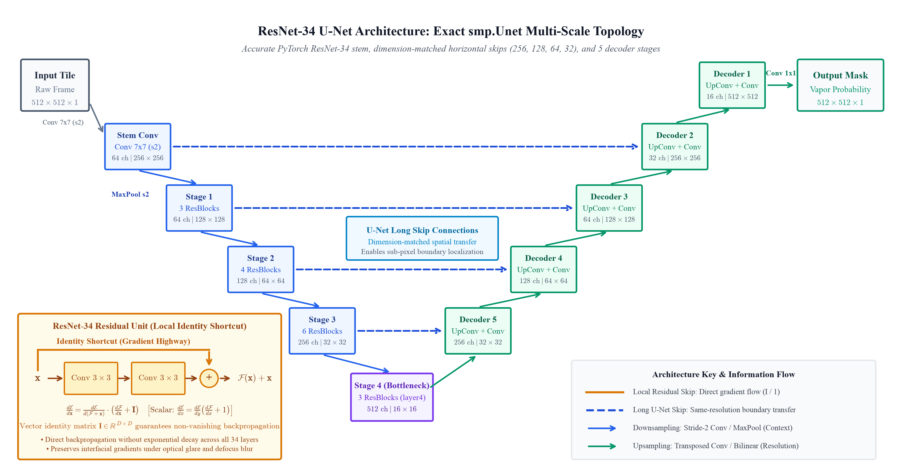

# Visualization (`visualization`)

Renderers, plots and interactive viewers. The pipeline stages in [`../model_training/`](../model_training/README.md) and the unified CLI (`main.py`) import these modules; each one also runs on its own.

| Script | Output | `main.py` command |
| :--- | :--- | :--- |
| `render_3d_flow.py` | Single-frame dual-regime 3D render (PNG) and WebGL HTML | `render` |
| `render_3d_flow_animation.py` | Multi-frame animated 3D WebGL player | `animate-3d` |
| `visualize_flow_animation.py` | Velocity-vector animation (MP4, GIF, interactive HTML) and vector CSV | `animate-flow` |
| `plot_void_fraction_timeline.py` | Void fraction timeline (PNG/PDF) and interactive dashboard | `plot-vf` |
| `generate_methodology_schematics.py` | Methodology schematics: chord geometry, tracking, DFD curves | — |
| `plot_resnet_unet_architecture.py`, `plot_resnet_gradient_highway.py`, `plot_resnet_intra_stage_highway.py` | Network architecture schematics | — |

## Usage

```bash
# 3D render of one mask
python visualization/render_3d_flow.py --mask dataset/masks/frame_0016.png \
  --output results/3d_bubble_render.png --interactive-html results/3d_bubble_render.html

# Animated 3D player
python visualization/render_3d_flow_animation.py --masks dataset_2/masks \
  --output-html results/interactive_3d_flow_viewer.html --max-frames 20 --pixel-size 5.175358e-05

# Velocity-vector animation
python visualization/visualize_flow_animation.py --masks dataset_2/masks \
  --images dataset_2/images --output-dir results/flow_animation --pixel-size 5.175358e-05

# Void fraction timeline from a CSV produced by `main.py void-fraction`
python visualization/plot_void_fraction_timeline.py --input results/void_fraction.csv \
  --output results/void_fraction_timeline.png --html results/void_fraction_timeline.html
```

The pixel size comes from a `0_*calibration.txt` next to the masks or from `--pixel-size`; there is no default, and the scripts stop if neither is available (`dataset_2/` ships without a calibration file, hence the explicit value above).

## Schematics

The schematic scripts write PDF and PNG files to `ctf2_article/figures/schematics` by default. Pass `--output-dir` to write elsewhere and leave the article figures untouched:

```bash
python visualization/generate_methodology_schematics.py --output-dir results/schematics
python visualization/plot_resnet_unet_architecture.py --output-dir results/schematics
```

The DFD curve schematic (`dfd_curves_regularization`) draws $f_1$ and $f_2$ from the same lookup table that `model_training/6_depth_from_defocus.py` inverts, so the figure and the computation cannot drift apart.


